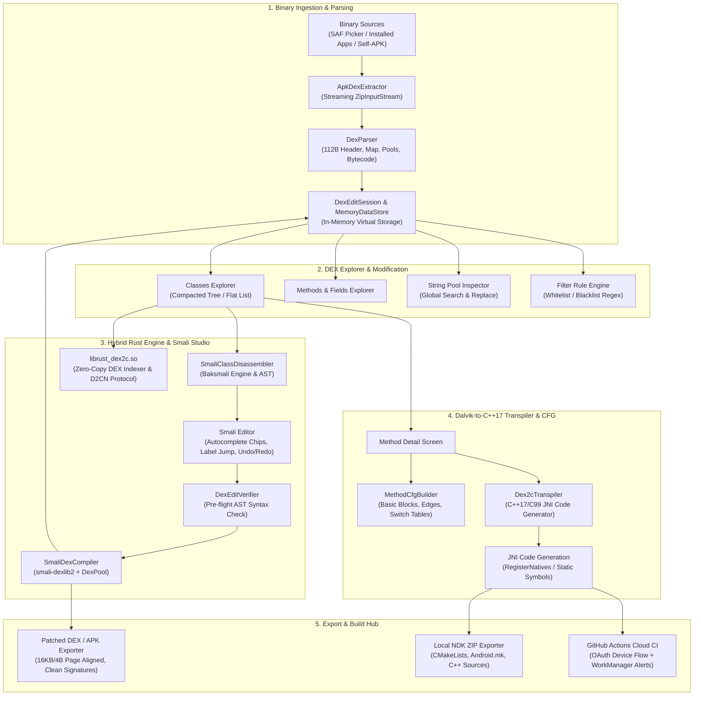
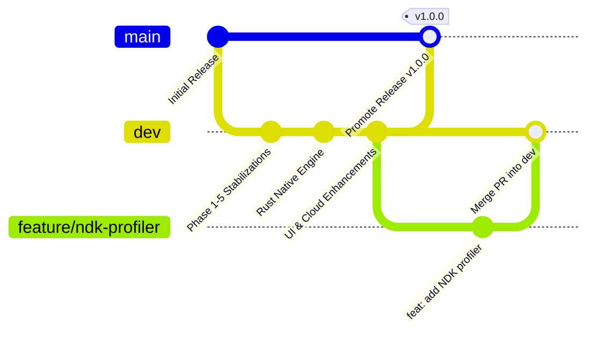

# Dex2C Studio — Dalvik Decompiler, In-Memory Smali Studio & C++17 Native Transpiler

<p align="center">
  
</p>

<p align="center">
  <strong>High-performance Android Dalvik bytecode analyzer, in-memory Smali editor, Java decompiler, Dalvik-to-C++17 JNI transpiler, and GitHub Actions Cloud CI orchestrator.</strong>
</p>

<p align="center">
  <a href="https://developer.android.com"></a>
  <a href="https://kotlinlang.org"></a>
  <a href="https://gradle.org"></a>
  <a href="https://www.rust-lang.org"></a>
  <a href="https://developer.android.com/jetpack/compose"></a>
  <a href="LICENSE"></a>
</p>

---

## 📖 Overview

**Dex2C Studio** (`com.dex2c.studio`) is a mobile reverse-engineering IDE and native compilation workbench designed for Android power users and security researchers. It bridges the gap between Dalvik bytecode analysis, interactive in-memory byte assembly, and high-performance native method transpilation into modern C++17 JNI code.

The application operates **100% in memory** using streaming ZIP/DEX extractors, random-access virtual data stores (`MemoryDataStore`), and bounded LRU caches to ensure zero disk leaks, zero residual temporary files, and maximum responsiveness on mobile devices.

---

## 🏗️ End-to-End System Architecture



---

## ✨ Key Features & Capabilities

### ⚡ 100% In-Memory Streaming & Virtual Storage
- **Zero Disk Residue**: Processes multi-gigabyte APKs and multi-DEX archives entirely in RAM through virtual data streams (`MemoryDataStore`), preventing flash storage degradation and leftover files.
- **Multi-DEX Support**: Ingests, inspects, and patches `classes.dex`, `classes2.dex`, etc., with on-the-fly switching and lazy pool resolution.

### 🦀 Modular Rust Native Engine (`rust-engine/`)
- **High-Performance Workspace**: 6 specialized Rust crates (`dex2c-core`, `dex2c-dex`, `dex2c-smali`, `dex2c-transpiler`, `dex2c-toolchain`, `dex2c-editor`).
- **D2CN Protocol**: Implements zero-copy DEX parsing, AST tokenization, and rapid string lookup via JNI bindings (`librust_dex2c.so`).

### 📝 Interactive Smali Studio & Java Decompiler
- **Interactive Disassembly**: Syntax-highlighted Smali viewer with collapsible method spans, register/label token highlighting, and interactive **Label Jump** (tap `:cond_*`, `:goto_*`, `:try_start_*`, `:switch_*` to instantly navigate).
- **Context-Aware Editor**: Auto-complete chips for Dalvik opcodes (`const-string`, `invoke-virtual`, `return-void`), registers (`v0`–`v15`, `p0`–`p4`), and class descriptors.
- **In-Memory DEX Compilation**: Assembles modified Smali back into DEX bytecode using `smali-dexlib2` and repacks multi-DEX structures in memory.

### ⚙️ Dalvik-to-C++17 Native Transpiler
- **Native JNI Generation**: Transpiles Dalvik bytecode into robust C++17 JNI code compatible with `codehasan/dex2c`.
- **Control Flow Graph (CFG)**: Generates basic block control flow graphs with conditional edge routing and switch tables.
- **NDK Resilience**: Supports Clang optimization, NDK r25c, and OLLVM (Obfuscator-LLVM) Studio toolchains.

### 🔍 Advanced Filter Rule Engine
- **Precise Targeting**: Build whitelist (`+W`) and blacklist (`!B`) regex rules to transpile specific security-critical classes or methods while preserving remaining bytecode.
- **Global String Pool Patcher**: Search and replace hardcoded strings, API keys, URLs, and labels across all classes in memory.

### ☁️ GitHub Actions Cloud CI Orchestration
- **Cloud NDK Builds**: Dispatch automated NDK C++ compilation workflows directly from your phone using GitHub OAuth Device Flow.
- **Live Build Monitor**: Real-time log streaming, ANSI escape sequence sanitization, failure-only views, and background completion alerts via `WorkManager`.

### 🎨 Material 3 & Adaptive Design
- **Material You Dynamic Theming**: Fully adaptive palette supporting light mode, dark mode, and system dynamic accents.
- **Form-Factor Responsive**: Seamlessly adapts to phones, tablets, and foldables with dual-pane master-detail Navigation3 scenes.

---

## 🏛️ Repository Asset Pillars

The repository includes 6 key knowledge, architecture, and developer asset suites:

| Asset Pillar | Path | Description |
| :--- | :--- | :--- |
| 📖 **Documentation Suite** | [`docs/`](docs/) | End-to-end workflows ([`detailed_app_workflow_and_usages.md`](docs/detailed_app_workflow_and_usages.md)), remediation roadmaps ([`dex2c_master_remediation_roadmap.md`](docs/dex2c_master_remediation_roadmap.md)), and phase specifications ([`phases.md`](docs/phases.md)). |
| 🌐 **Knowledge Graph** | [`graphify-out/`](graphify-out/) | AST-based codebase knowledge graph ([`graph.html`](graphify-out/graph.html)), interactive call flow ([`Dex2c-Android-callflow.html`](graphify-out/Dex2c-Android-callflow.html)), and collapsible tree ([`GRAPH_TREE.html`](graphify-out/GRAPH_TREE.html)). |
| 🏛️ **Architecture Visualizer** | [`.archify/`](.archify/) | Standalone explorable HTML system architecture model ([`dex2c-studio-architecture.html`](.archify/architecture-dex2c-studio-20261120-095500/dex2c-studio-architecture.html)). |
| 🛠️ **Developer Scripts** | [`scripts/`](scripts/) | Rust NDK build script ([`build_rust_engine.ps1`](scripts/build_rust_engine.ps1)), GitHub Actions log cleaner ([`delete_workflow_runs.py`](scripts/delete_workflow_runs.py)), and vector brand generators. |
| 🖼️ **Public Assets & UI Gallery** | [`public/assets/`](public/assets/) | High-resolution UI captures, screen progressions, and AI Studio build telemetry logs. |
| 🛡️ **Security Audit** | [`.security-audit/`](.security-audit/) | Formal defensive security review ([`REPORT.md`](.security-audit/run-1/REPORT.md)), attack surface analysis, and vulnerability remediation ledger. |

---

## 📂 Repository Layout

```
Dex2c-Android/
├── .archify/                    # Interactive architecture visualization HTML & JSON
├── .github/
│   └── workflows/build.yml      # CI workflow for tests, debug & release split builds
├── .security-audit/             # Defensive security review report & findings ledger
├── app/                         # Android application module
│   ├── src/main/java/           # Kotlin source code (UI, transpiler, cloud, dex engines)
│   ├── src/main/jniLibs/        # Pre-built native shared libraries (arm64-v8a, armeabi-v7a, x86_64)
│   └── src/test/java/           # Comprehensive JUnit & Robolectric test suite (23 test files)
├── docs/                        # Architecture specs, phase plans, and workflow guides
├── graphify-out/                # AST knowledge graph, call-flow diagram, and architecture reports
├── public/assets/               # Screenshots, UI captures, and build logs
├── rust-engine/                 # Modular Rust native workspace (6 crates)
│   ├── crates/dex2c-core/       # Core AST & shared types
│   ├── crates/dex2c-dex/        # Zero-copy DEX parser & indexer
│   ├── crates/dex2c-smali/      # Smali lexer & AST builder
│   ├── crates/dex2c-transpiler/ # Dalvik-to-C++ transpilation engine
│   ├── crates/dex2c-toolchain/  # NDK / Clang toolchain invocations
│   └── crates/dex2c-editor/     # High-performance code editor tokenization
├── scripts/                     # PowerShell and Python build/maintenance utilities
├── WORKFLOW.md                  # Comprehensive end-to-end technical blueprint
└── README.md                    # Repository documentation (this file)
```

---

## 🌿 Git Branching Strategy & Workflow

To maintain repository hygiene and ensure stability, all branches follow this governance structure:



### Branch Roles
- **`main`**: Production & Stable Releases. Contains official, fully verified code. Direct pushes are disabled. Tagged with SemVer (`v1.0.0`, `v1.1.0`).
- **`dev`**: Primary Integration Branch. Default working branch where feature branches merge.
- **`feature/*` / `fix/*`**: Short-lived topic branches branched off `dev` and merged back into `dev` via PR or rebase.

---

## 🚀 Getting Started & Build Instructions

### Prerequisites
- **Android Studio**: Ladybug (2024.2.1+) or newer
- **JDK**: OpenJDK 21 or newer
- **Android SDK**: Compile SDK `37`, Target SDK `36`, Min SDK `24`
- **Android NDK**: `r25c` or `r25c-ollvm` (recommended: NDK r25c)
- **Rust Toolchain**: Rust 1.80+ (`cargo`, `rustc`) with `cargo-ndk` (optional, for compiling Rust shared libraries locally)

### 1. Clone the Repository
```bash
git clone https://github.com/Roni077/Dex2c-Android.git
cd Dex2c-Android
git checkout dev
```

### 2. Build the Rust Native Engine (Optional)
Pre-built libraries are included in `app/src/main/jniLibs/`. If you modify `rust-engine/`, compile native shared libraries using the automated script:
```powershell
powershell -ExecutionPolicy Bypass -File scripts/build_rust_engine.ps1
```

### 3. Build the Android Application

#### Debug APK
```bash
./gradlew assembleDebug
```
Output APK location: `app/build/outputs/apk/debug/app-debug.apk`

#### Release Split APKs (arm64-v8a, armeabi-v7a, universal)
```bash
./gradlew assembleRelease
```
Output APKs location: `app/build/outputs/apk/release/`

### 4. Run Automated Tests
```bash
./gradlew testDebugUnitTest
```
To run the Rust workspace validation:
```bash
cd rust-engine && cargo check --workspace && cd ..
```

---

## 🧪 Testing & Quality Assurance

Dex2C Studio is backed by a 23-test-file automated suite covering:
- **Unit & AST Verification**: `Dex2cTranspilerTest`, `DexDisassemblerAndSmaliTest`, `ClangSyntaxValidationTest`.
- **In-Memory DEX Verification**: `DexEditSessionTest`, `DexEditVerifierTest`, `Phase1DexRemediationTest`.
- **Robolectric UI Tests**: `AdaptiveLayoutRobolectricTest`, `ClassSelectionTabsRobolectricTest`, `MainActivityStartupRobolectricTest`.
- **Security & Cloud Tests**: `Phase3SecurityAndNetworkTest`, `GitHubCloudWorkflowTest`.

---

## 🤝 Contributing

1. Fork or branch from `dev`:
   ```bash
   git checkout dev
   git pull origin dev
   git checkout -b feature/your-feature-name
   ```
2. Commit your changes following [Conventional Commits](https://www.conventionalcommits.org/):
   ```bash
   git commit -m "feat(transpiler): add support for packed-switch optimization"
   ```
3. Verify test suite:
   ```bash
   ./gradlew testDebugUnitTest
   ```
4. Push your branch and open a Pull Request targeting `dev`.

---

## 📄 License & Acknowledgments

- **Dex2C Studio** is open source software licensed under [MIT License](LICENSE).
- Built upon and inspired by:
  - **[codehasan/dex2c](https://github.com/codehasan/dex2c)**: Dalvik-to-C transpilation algorithms.
  - **[Google smali/baksmali](https://github.com/google/smali)**: Dalvik bytecode disassembler and assembler.
  - **[Rosemoe sora-editor](https://github.com/Rosemoe/sora-editor)**: High-performance mobile code editor.
  - **[Android Jetpack](https://developer.android.com/jetpack)**: Jetpack Compose, Navigation Compose, Room, WorkManager.

---

<p align="center">
  <strong>Maintained by <a href="https://github.com/Roni077">Roni077</a></strong>
</p>
