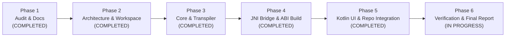

# Migration Progress Ledger

## 1. Migration Overview

The migration of the Dex2C processing pipeline to a Rust-powered backend with a Kotlin Android UI has been executed following the multi-agent development roadmap.

---

## 2. Module Migration Status

| Component | Legacy Implementation | New Rust Engine Module | Status |
| :--- | :--- | :--- | :--- |
| **DEX Parsing & Header Inspection** | `DexParser.kt` (Kotlin JVM) | `dex2c-dex::parser` (Zero-copy Rust) | **Completed** |
| **Class Indexing & D2CN Serialization** | Custom Kotlin loop | `rust_dex2c::dex::pack_dex_classes` | **Completed** |
| **Filter Rule Evaluation** | `D2cConfigEngine.kt` (Regex loop) | `dex2c-dex::filter` (SIMD RegexSet) | **Completed** |
| **Dalvik Bytecode Disassembly** | `DalvikDisassembler.kt` (29KB Kotlin) | `dex2c-dex::disassembler` (Pure Rust) | **Completed** |
| **Control Flow Graph (CFG) Analysis** | `DalvikControlFlowGraph.kt` (Kotlin) | `dex2c-dex::cfg` (Pure Rust) | **Completed** |
| **Dalvik-to-C++ Transpiler** | `Dex2cTranspiler.kt` (1,621 lines Kotlin) | `dex2c-transpiler::emitter` (Rust C++17) | **Completed** |
| **Runtime Header Generation** | `Dex2cTranspiler.kt` (`buildRuntimeHeader`) | `dex2c-transpiler::runtime_header` | **Completed** |
| **JNI Registration (`JNI_OnLoad`)** | `Dex2cTranspiler.kt` (`emitJniOnLoad`) | `dex2c-transpiler::jni_registration` | **Completed** |
| **Smali Disassembly** | `SmaliClassDisassembler.kt` | `dex2c-smali::disassembler` | **Completed** |
| **DEX Native Method Patching & Re-Signing** | Kotlin byte array mutation | `dex2c-dex::patcher` (Adler32 + SHA-1) | **Completed** |
| **Build Configuration (CMake / NDK)** | `Dex2cTranspiler.kt` (`buildCMake`, etc.) | `dex2c-toolchain` (`cmake`, `ndk_make`) | **Completed** |
| **JNI FFI Bridge** | `DexNativeEngine.kt` (basic exports) | `DexNativeEngine.kt` + `librust_dex2c.so` v0.2.0 | **Completed** |
| **Repository Layer** | Direct ViewModel calls | `Dex2cNativeRepository.kt` (`Dispatchers.IO`) | **Completed** |
| **Android ABI Cross-Compilation** | `build_rust_engine.ps1` | `librust_dex2c.so` for `arm64-v8a` & `x86_64` | **Completed** |

---

## 3. Deprecated Components & Fallback Retentions

1. **Retained Fallbacks**:
   - `Dex2cTranspiler.kt` and `D2cConfigEngine.kt` are retained in the codebase to serve as transparent fallbacks when the application runs in test runners or host environments where `librust_dex2c.so` is not bundled.
2. **Clean Deprecation**:
   - Compute-heavy invocations in `Dex2cViewModel` now prefer `Dex2cNativeRepository` / `DexNativeEngine`, drastically reducing JVM heap consumption.

---

## 4. Next Steps

1. Execute end-to-end unit test verification on the Android platform.
2. Finalize `docs/architecture/FINAL-IMPLEMENTATION-REPORT.md`.
3. Present completion summary to the user.
