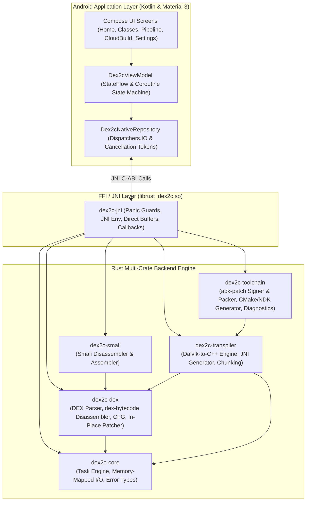

# Rust Backend Architecture Specification

## 1. Architectural Overview

The target backend architecture establishes a high-performance, modular **Rust workspace** that handles the complete Dex2C processing pipeline natively. Kotlin acts strictly as the client platform and UI orchestrator, communicating with Rust across a stable, panic-guarded, zero-copy JNI boundary.



---

## 2. Workspace & Crate Layout

The backend is organized into a Cargo workspace containing the following crates:

### 2.1 `dex2c-core`
- **Responsibilities**: Shared domain models, task management, progress reporting, structured error definitions (`Dex2cError`), memory-mapped I/O (`memmap2`), and atomic cancellation primitives (`AtomicBool`).
- **Dependencies**: `thiserror`, `log`, `serde`, `serde_json`, `parking_lot`, `memmap2`.

### 2.2 `dex2c-dex`
- **Responsibilities**:
  - High-performance, zero-copy structural DEX parsing (`DexFile`).
  - Multi-DEX aggregation (`classes.dex`, `classes2.dex`, etc.).
  - Dalvik opcode disassembly and payload decoding powered by **`androguard/dex-bytecode`**.
  - Control Flow Graph (CFG) analysis, basic block partitioning, and try/catch exception edge extraction.
  - In-place DEX method native patching (`ACC_NATIVE = 0x0100`, `code_off = 0`) with Adler32 checksum and SHA-1 signature recomputation.
- **Dependencies**: `dex2c-core`, `dex-bytecode`, `regex`.

### 2.3 `dex2c-smali`
- **Responsibilities**:
  - Dalvik bytecode to Smali text disassembly with formatting compliant with Google Smali 2.5.2.
  - Smali text tokenizer and assembler producing Dalvik bytecodes.
- **Dependencies**: `dex2c-core`, `dex2c-dex`.

### 2.4 `dex2c-transpiler`
- **Responsibilities**:
  - Full parity port of Kotlin's 1,621-line `Dex2cTranspiler.kt`.
  - Converts Dalvik instruction sequences into clean, type-safe C++17 JNI code.
  - Generates `d2c_runtime.h` containing null checks, JNI call helper macros, and register unions.
  - Generates `JNI_OnLoad` dynamic registration (`RegisterNatives`) or static JNI export signatures.
  - Manages method chunking (`DEFAULT_METHODS_PER_CHUNK = 250`) and parallel code emission via `rayon`.
- **Dependencies**: `dex2c-core`, `dex2c-dex`, `rayon`.

### 2.5 `dex2c-toolchain`
- **Responsibilities**:
  - Generates modern `CMakeLists.txt` and `Android.mk` / `Application.mk` build files with support for Obfuscator-LLVM (OLLVM) flags and 16 KB ELF page alignment (`-Wl,-z,max-page-size=16384`).
  - Streaming ZIP bundle exporter producing `dex2c-bundle.zip`.
  - Integrates **`androguard/apk-patch`** for pure-Rust in-memory APK unpacking, DEX insertion, and APK signing (v1, v2, v3 signature schemes).
  - Diagnostic parser for compiler error and warning formatting.
- **Dependencies**: `dex2c-core`, `dex2c-transpiler`, `zip`, `apk-patch`.

### 2.6 `dex2c-jni` (Root `rust_dex2c` cdylib)
- **Responsibilities**:
  - Exports C-ABI JNI functions matching `com.dex2c.studio.nativeengine.DexNativeEngine`.
  - Enforces `std::panic::catch_unwind` across every JNI entry point.
  - Translates Rust errors into structured Kotlin exceptions.
  - Dispatches non-blocking progress updates via JNI callback interfaces.
- **Dependencies**: `jni`, all internal workspace crates.

---

## 3. Kotlin-Rust Communication Architecture

### 3.1 JNI Boundary Rules
1. **Zero Raw Byte Duplication**: Large DEX files are accessed via memory-mapped buffers (`memmap2`) or direct byte buffers (`new_direct_byte_buffer`). File paths or file descriptors from Android's Storage Access Framework (SAF) are passed instead of copying arrays across JNI.
2. **Panic Safety**: Every native export wraps internal execution in `std::panic::catch_unwind(AssertUnwindSafe(|| ...))`. Any unexpected panic is caught and mapped to a structured error code, preventing process termination.
3. **Safe Handle Lifetime**: Native objects are boxed (`Box<T>`) and returned as opaque handles (`jlong`). Handles are validated against an internal registry before dereferencing and safely freed on `nativeCloseDex`.
4. **Structured Error Propagation**: Rather than silent null returns, operations return an error code or JSON string detailing the exact failure stage and trigger.

### 3.2 Progress Reporting & Cancellation
```
Kotlin Repository                        Rust Native Engine
      |                                          |
      | --- nativeTranspileAsync(handle, cb) --> | (Spawns worker thread)
      |                                          |
      | <--- onProgress(stage, percent, msg) --- | (JNI method call to Kotlin)
      | <--- onProgress(stage, percent, msg) --- |
      |                                          |
      | --- nativeCancelTask(taskId) ----------> | (Sets AtomicBool token)
      |                                          | (Graceful worker abort)
      | <--- onCompleted(status, bundlePath) --- |
```

---

## 4. Concurrency & Memory Strategy

1. **Memory-Mapped I/O**: Multi-DEX binaries (50–100MB+) are opened via OS paging, avoiding heap bloat on RAM-constrained devices.
2. **Bounded Thread Pools**: Compute-intensive tasks (batch instruction translation, multi-class disassembling) use `rayon` with thread count bounded to available CPU cores (`num_cpus`).
3. **Zero-Allocation Data Slices**: Where possible, class descriptors and method prototypes borrow directly from the DEX memory slice (`&'a str`), minimizing string heap allocation.
