# Implementation Plan: Chinese Obfuscation for `com.dex2c.studio` Classes & Methods

## Goal Description
Implement the user's **Chinese Identifier Specification Matrix**:
Convert all Kotlin/Java class names, method names, and variables under `com.dex2c.studio` into Chinese characters (using `app/obfuscation-dictionary.txt`), while strictly avoiding Chinese for Package/Application ID and JNI native C/C++ symbols so the app runs stably without OS or native linkage failures.

---

## Authoritative Chinese Identifier Matrix

The implementation adheres to the following specification:

| Project Component | Chinese Identifiers | Implementation & ProGuard / R8 Strategy | Status |
| :--- | :---: | :--- | :---: |
| **Kotlin class names** | **Supported** | Obfuscated via `-classobfuscationdictionary obfuscation-dictionary.txt` by removing blanket `-keep` rules on `apk`, `cloud`, `data`, `dex`, `transpiler`. | ✅ **Chinese** |
| **Kotlin method names** | **Supported** | Obfuscated via `-obfuscationdictionary obfuscation-dictionary.txt`. | ✅ **Chinese** |
| **Kotlin variables** | **Supported** | Obfuscated via `-obfuscationdictionary obfuscation-dictionary.txt`. | ✅ **Chinese** |
| **Java class names** | **Supported** | Obfuscated via `-classobfuscationdictionary obfuscation-dictionary.txt`. | ✅ **Chinese** |
| **Java methods** | **Supported** | Obfuscated via `-obfuscationdictionary obfuscation-dictionary.txt`. | ✅ **Chinese** |
| **Java variables** | **Supported** | Obfuscated via `-obfuscationdictionary obfuscation-dictionary.txt`. | ✅ **Chinese** |
| **Rust identifiers** | **Supported** | Rust internal non-exported functions/types support UTF-8 Unicode identifiers. | ✅ **Supported** |
| **Package / application ID** | **Avoid** | **Preserved as ASCII `com.dex2c.studio`**. Repackaging via `-repackageclasses 'com.dex2c.studio'` places all Chinese classes directly inside `com.dex2c.studio.<ChineseClass>`. Android OS package manager and Google Play require ASCII application IDs. | 🛡️ **Avoid (ASCII)** |
| **JNI / native C/C++ symbols** | **Avoid** | **Preserved as ASCII**. `Java_com_dex2c_studio_nativeengine_DexNativeEngine_*` and `Java_com_dex2c_studio_nativeengine_EditorNativeEngine_*` must remain ASCII to match the compiled `librust_dex2c.so` ELF symbol table and prevent `UnsatisfiedLinkError`. | 🛡️ **Avoid (ASCII)** |

---

## Demonstration: Before vs. After Breakdown

### 1. Package & Class Repackaging Map

```mermaid
flowchart LR
    subgraph Avoid_ASCII["Package & JNI Bridge (Avoid Chinese - Keep ASCII)"]
        PKG["Application ID: 'com.dex2c.studio'"]
        JNI1["DexNativeEngine.native*()"]
        JNI2["EditorNativeEngine.native*()"]
        LAUNCH["MainActivity (OS Launcher)"]
    end

    subgraph Supported_Chinese["Classes, Methods & Variables (Supported - Chinese)"]
        direction TB
        C1["Dex2cTranspiler ➔ com.dex2c.studio.喵"]
        C2["ApkMetadataInspector ➔ com.dex2c.studio.猫"]
        C3["GitHubApiClient ➔ com.dex2c.studio.龍"]
        C4["CloudSettings ➔ com.dex2c.studio.凤"]
        C5["RecentFilesStore ➔ com.dex2c.studio.玄"]
        C6["D2cnBinaryDecoder ➔ com.dex2c.studio.黄"]
        
        M1["buildAndroidMk() ➔ 喵()"]
        M2["queryLaunchableApps() ➔ 猫()"]
        M3["parseObject() ➔ 龍()"]
        M4["executeTranspile() ➔ 凤()"]
        
        V1["val isAvailable ➔ val 喵"]
        V2["val accessToken ➔ val 猫"]
    end

    Avoid_ASCII -. hosts .-> Supported_Chinese
```



---

### 2. Breakdown Across the 259 `com.dex2c.studio` Classes

| Package | Class Count | Kotlin/Java Classes, Methods, Variables | Package & JNI Bridge |
| :--- | :---: | :--- | :--- |
| `com.dex2c.studio.transpiler` | **26** | **All 26 classes, methods, variables ➔ Chinese (`喵`, `猫`, etc.)** | Repackaged under `com.dex2c.studio` |
| `com.dex2c.studio.dex` | **87** | **All 87 classes, methods, variables ➔ Chinese (`玄`, `黄`, etc.)** | Repackaged under `com.dex2c.studio` |
| `com.dex2c.studio.cloud` | **64** | **All 63 models, clients, parsers ➔ Chinese**<br>*(Only worker name kept for WorkManager)* | Repackaged under `com.dex2c.studio` |
| `com.dex2c.studio.data` & `repository` | **57** | **All 57 preferences, repos, stores ➔ Chinese** | Repackaged under `com.dex2c.studio` |
| `com.dex2c.studio.apk` | **14** | **All 14 inspectors, filters, items ➔ Chinese** | Repackaged under `com.dex2c.studio` |
| `com.dex2c.studio.nativeengine` | **8** | **6 classes (tokens, buffers, fallback) ➔ Chinese**<br>All internal fields & non-native methods ➔ Chinese | 2 JNI facades (`DexNativeEngine`, `EditorNativeEngine`) keep native entrypoints |
| `com.dex2c.studio` (root) | **3** | `LocalizedActivityContext` ➔ Chinese<br>`MainActivity` internal methods/variables ➔ Chinese | `MainActivity` class name kept for launcher |
| **Total** | **259** | **255 Classes & Thousands of Methods/Variables in Chinese** | **Base Package & JNI linkage preserved** |

---

### 3. Concrete Code Decompilation Preview

````carousel
```java
// BEFORE (Currently visible in MT Manager / Jadx)
package com.dex2c.studio.transpiler;

public class Dex2cTranspiler {
    public static final String TAG = "Dex2cTranspiler";
    private boolean isInitialized = false;

    public String buildAndroidMk(TranspilerConfig config) {
        StringBuilder sb = new StringBuilder();
        sb.append("LOCAL_PATH := $(call my-dir)\n");
        return sb.toString();
    }

    public boolean executeTranspile(File outputDir, TranspilerConfig config) {
        return true;
    }
}
```
<!-- slide -->
```java
// AFTER (What will be decompiled after applying the plan)
package com.dex2c.studio;

public class 喵 {
    public static final String 喵 = "Dex2cTranspiler";
    private boolean 猫 = false;

    public String 龍(玄 凤) {
        StringBuilder sb = new StringBuilder();
        sb.append("LOCAL_PATH := $(call my-dir)\n");
        return sb.toString();
    }

    public boolean 黄(File 宇, 玄 凤) {
        return true;
    }
}
```
````

---

## Implementation Steps

### 1. Refactor `app/proguard-rules.pro`

- **Remove blanket keeps** (lines 32–40) so R8 can obfuscate all Kotlin/Java classes, methods, and variables:
  ```proguard
  # REMOVE:
  -keep class com.dex2c.studio.nativebridge.** { *; }
  -keep class com.dex2c.studio.nativeengine.** { *; }
  -keep class com.dex2c.studio.apk.** { *; }
  -keep class com.dex2c.studio.cloud.** { *; }
  -keep class com.dex2c.studio.data.** { *; }
  -keep class com.dex2c.studio.dex.** { *; }
  -keep class com.dex2c.studio.transpiler.** { *; }
  ```

- **Surgical JNI keep rules** (preserves JNI/native C/C++ symbols as ASCII per matrix):
  ```proguard
  # Preserve Rust JNI entrypoint facades (ASCII JNI bridge)
  -keep class com.dex2c.studio.nativeengine.DexNativeEngine {
      native <methods>;
  }
  -keep class com.dex2c.studio.nativeengine.EditorNativeEngine {
      native <methods>;
  }
  -keepnames class com.dex2c.studio.cloud.CloudBuildMonitorWorker
  ```

- **Repackage classes** (preserves ASCII package ID `com.dex2c.studio` per matrix while flattening Chinese classes):
  ```proguard
  -repackageclasses 'com.dex2c.studio'
  -allowaccessmodification
  ```

- **Enum constants preservation**:
  ```proguard
  -keepclassmembers enum * {
      public static **[] values();
      public static ** valueOf(java.lang.String);
      public static **[] $VALUES;
      public static final ** *;
  }
  ```

### 2. Update `app/build.gradle.kts`
- Keep `release` with `isMinifyEnabled = true`, `isShrinkResources = true`.
- Support `dex2c.minifyDebug` flag for debug builds.

---

## Verification Plan

1. **Local Build**:
   Run `./gradlew.bat assembleRelease -x test` to build `app-arm64-v8a-release.apk`.
2. **DEX Bytecode Inspection**:
   Run Python script to verify:
   - Kotlin/Java class names: converted to Chinese (`Lcom/dex2c/studio/<ChineseChar>;`).
   - Kotlin/Java method names: converted to Chinese.
   - Kotlin/Java variables: converted to Chinese.
   - Package ID: remains `com.dex2c.studio`.
   - JNI native methods: remain intact without `UnsatisfiedLinkError`.
3. **Update Knowledge Graph**:
   Run `graphify update .`.
