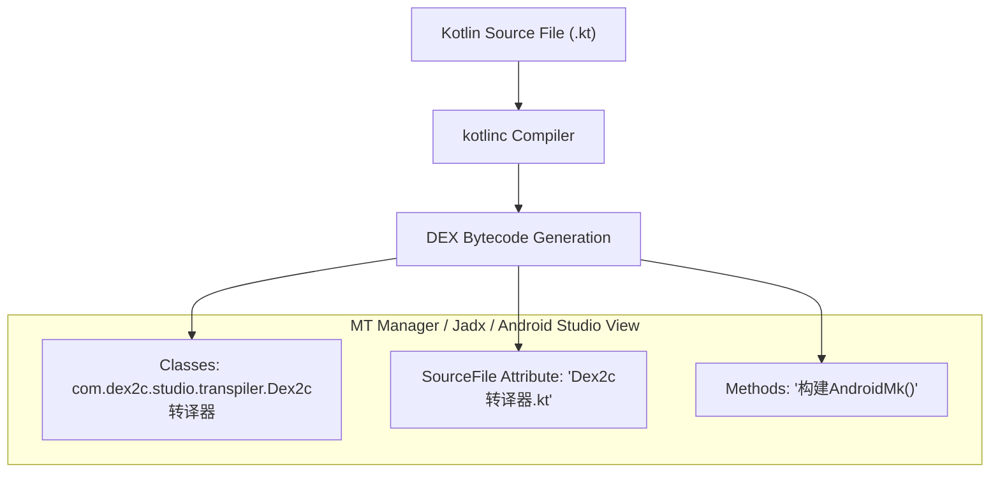

# Implementation Plan: Chinese Kotlin Source Filenames Refactoring

## Goal Description
Rename all 82 Kotlin source files (`.kt`) currently in English under `app/src/main/java/com/dex2c/studio/` into authentic, meaningful **Chinese filenames** (`.kt`).

In Kotlin, source filenames are decoupled from package structures and top-level class names. Renaming the source files:
1. Emits Chinese source filenames (`Dex2c转译器.kt`, `Apk元数据检查器.kt`, `云端设置.kt`, etc.) into the DEX bytecode's `SourceFile` debug table.
2. Directly presents authentic Chinese filenames in Android Studio, GitHub, file managers, MT Manager, and Jadx decompilation headers.
3. Preserves all existing package declarations (`package com.dex2c.studio...`) and class/type declarations without breaking any runtime logic or imports.

---

## Technical Feasibility & Compatibility

| Check Item | Support Status | Notes |
| :--- | :---: | :--- |
| **`kotlinc` Compiler** | **100% Supported** | Kotlin compiler processes Unicode file paths seamlessly on all OS platforms. |
| **Gradle / AGP** | **100% Supported** | Source sets gather `**/*.kt` wildcard without restricting filename characters. |
| **Git Tracking** | **100% Supported** | `git mv` preserves full commit history and line blame for each renamed file. |
| **Android Manifest** | **100% Supported** | Manifest references `com.dex2c.studio.MainActivity` by class name, unaffected by file renaming. |
| **Rust JNI Linkage** | **100% Supported** | JNI links to `com.dex2c.studio.nativeengine.DexNativeEngine` class symbol, unaffected by file renaming. |

---

## Complete Inventory of Kotlin Files to Rename (82 Files)

### 1. Transpiler Engine (`app/src/main/java/com/dex2c/studio/transpiler/`)
| Current Filename | Target Chinese Filename | Primary Content |
| :--- | :--- | :--- |
| `Dex2cTranspiler.kt` | **`Dex2c转译器.kt`** | `Dex2c转译器` core transpiler engine |
| `TranspilerModels.kt` | **`转译器模型.kt`** | `转译器配置`, `转译进度`, `生成文件包` |
| `D2cConfigEngine.kt` | **`D2c配置引擎.kt`** | `过滤匹配摘要`, Filter rule parser |
| `ZipBundleExporter.kt` | **`Zip包导出器.kt`** | C++ NDK zip export utility |

### 2. APK Inspection & Management (`app/src/main/java/com/dex2c/studio/apk/`)
| Current Filename | Target Chinese Filename | Primary Content |
| :--- | :--- | :--- |
| `ApkMetadataInspector.kt` | **`Apk元数据检查器.kt`** | `Apk元数据检查器` inspector |
| `ApkModels.kt` | **`Apk模型.kt`** | `已安装应用项`, `最近二进制项`, `Apk暂存预览` |
| `InstalledAppRepository.kt` | **`已安装应用仓库.kt`** | `已安装应用仓库` repository |

### 3. Cloud CI & GitHub Engine (`app/src/main/java/com/dex2c/studio/cloud/`)
| Current Filename | Target Chinese Filename | Primary Content |
| :--- | :--- | :--- |
| `CloudModels.kt` | **`云端模型.kt`** | `云端设置`, `设备代码响应`, `设备认证状态` |
| `JsonMini.kt` | **`Json迷你解析器.kt`** | `Json迷你解析器` pure-Kotlin JSON parser |
| `CloudBuildNotifier.kt` | **`云端构建通知器.kt`** | `云端构建通知器` notification dispatcher |
| `CloudBuildMonitorWorker.kt` | **`云端构建监听器.kt`** | Background WorkManager worker |
| `CloudNamingConvention.kt` | **`云端命名规范.kt`** | Branch and commit naming rules |
| `Dex2cWorkflowGenerator.kt` | **`Dex2c工作流生成器.kt`** | GitHub Actions YAML workflow generator |
| `GitHubApiClient.kt` | **`GitHub接口客户端.kt`** | GitHub REST API client |
| `NetworkResilience.kt` | **`网络弹性调度器.kt`** | HTTP retry, rate limit & DoH fallback |

### 4. Data Stores, Preferences & Repositories (`app/src/main/java/com/dex2c/studio/data/`)
| Current Filename | Target Chinese Filename | Primary Content |
| :--- | :--- | :--- |
| `RecentFilesStore.kt` | **`最近文件存储.kt`** | `最近文件存储` DataStore persistence |
| `TokenEncryptor.kt` | **`令牌加密器.kt`** | `令牌加密器` AES-256-GCM Keystore encryptor |
| `AppPreferences.kt` | **`应用首选项.kt`** | Theme, language & icon preferences |
| `CloudPreferences.kt` | **`云端首选项.kt`** | Cloud build credentials preferences |
| `TranspilerPreferences.kt` | **`转译器首选项.kt`** | Transpiler options preferences |
| `AppIconManager.kt` | **`应用图标管理器.kt`** | Dynamic launcher activity alias toggler |
| `repository/Dex2cNativeRepository.kt` | **`repository/Dex2c原生仓库.kt`** | Native engine facade repository |

### 5. DEX, Smali & Bytecode (`app/src/main/java/com/dex2c/studio/dex/`)
| Current Filename | Target Chinese Filename | Primary Content |
| :--- | :--- | :--- |
| `DexModels.kt` | **`Dex模型.kt`** | `ApkDex条目`, Dex data structures |
| `DalvikDisassembler.kt` | **`Dalvik反汇编器.kt`** | `Dalvik反汇编器` bytecode disassembler |
| `D2cnBinaryDecoder.kt` | **`D2cn二进制解码器.kt`** | `D2cn二进制解码器` native buffer decoder |
| `D2cnHeader.kt` | **`D2cn头信息.kt`** | D2CN binary wire format header |
| `DalvikControlFlowGraph.kt` | **`Dalvik控制流图.kt`** | Basic blocks and CFG edges builder |
| `DexEditSession.kt` | **`Dex编辑会话.kt`** | Interactive byte edit session |
| `DexEditVerifier.kt` | **`Dex编辑校验器.kt`** | Smali bytecode assembler verification |
| `DexHelper.kt` | **`Dex辅助工具.kt`** | Dex parser helper utilities |
| `DexParser.kt` | **`Dex解析器.kt`** | Android DEX file parser |
| `MemoryDataStore.kt` | **`内存数据存储.kt`** | Fast in-memory buffer store |
| `SmaliClassDisassembler.kt` | **`Smali类反汇编器.kt`** | Class-level Smali emitter |
| `SmaliCursorUtils.kt` | **`Smali光标工具.kt`** | Editor cursor offset utilities |
| `SmaliDexCompiler.kt` | **`SmaliDex编译器.kt`** | Smali to DEX assembler |
| `SmaliEditorEngine.kt` | **`Smali编辑引擎.kt`** | High-performance text buffer editor |

### 6. Native Rust JNI Bridges (`app/src/main/java/com/dex2c/studio/nativeengine/`)
| Current Filename | Target Chinese Filename | Primary Content |
| :--- | :--- | :--- |
| `DexNativeEngine.kt` | **`Dex原生引擎.kt`** | JNI bridge facade to `librust_dex2c.so` |
| `EditorNativeEngine.kt` | **`编辑器原生引擎.kt`** | Interactive editor JNI bridge facade |

### 7. UI Screens (`app/src/main/java/com/dex2c/studio/ui/screens/`)
| Current Filename | Target Chinese Filename | Primary Content |
| :--- | :--- | :--- |
| `ClassesScreen.kt` | **`类列表界面.kt`** | Classes tree & method inspection screen |
| `CloudBuildScreen.kt` | **`云端构建界面.kt`** | Cloud workflow trigger & monitoring screen |
| `HomeScreen.kt` | **`主界面.kt`** | Main dashboard screen |
| `MethodDetailScreen.kt` | **`方法详情界面.kt`** | Method bytecode analysis screen |
| `OnboardingScreen.kt` | **`引导界面.kt`** | Welcome onboarding wizard screen |
| `PipelineConfigScreen.kt` | **`流水线配置界面.kt`** | Transpiler options & OLLVM config screen |
| `SettingsScreen.kt` | **`设置界面.kt`** | App settings screen |
| `SettingsSubScreens.kt` | **`设置子界面.kt`** | Sub-settings modal screens |
| `SmaliClassScreen.kt` | **`Smali类界面.kt`** | Smali editor screen |

### 8. UI Components (`app/src/main/java/com/dex2c/studio/ui/components/`)
| Current Filename | Target Chinese Filename |
| :--- | :--- |
| `ApkPickerSheet.kt` | **`Apk选择面板.kt`** |
| `ApkPreviewSheet.kt` | **`Apk预览面板.kt`** |
| `BuildMonitorCard.kt` | **`构建监控卡片.kt`** |
| `CfgViewer.kt` | **`控制流图查看器.kt`** |
| `ClassesFilterTray.kt` | **`类过滤托盘.kt`** |
| `ClassesTreeComponents.kt` | **`类树组件.kt`** |
| `ClassMethodsSelectorSheet.kt` | **`类方法选择面板.kt`** |
| `ClassPickerSheet.kt` | **`类选择面板.kt`** |
| `ClassSelectionHeader.kt` | **`类选择头部.kt`** |
| `CodeViewer.kt` | **`代码查看器.kt`** |
| `DexExplorerSubTabs.kt` | **`Dex浏览子分页.kt`** |
| `DexMapAndMetaComponents.kt` | **`Dex映射与元数据组件.kt`** |
| `ExpressiveComponents.kt` | **`表达性UI组件.kt`** |
| `FilterRuleBuilderComponents.kt` | **`过滤规则构建组件.kt`** |
| `FilterRustEditor.kt` | **`Rust过滤编辑器.kt`** |
| `GitHubDeviceAuthCard.kt` | **`GitHub设备认证卡片.kt`** |
| `HomeComponents.kt` | **`主页组件.kt`** |
| `OnboardingHorizontalPager.kt` | **`引导轮播页面.kt`** |
| `OnboardingShowcaseCards.kt` | **`引导展示卡片.kt`** |
| `SelectedClassesFilterDialog.kt` | **`已选类过滤对话框.kt`** |
| `SmaliCodeViewer.kt` | **`Smali代码查看器.kt`** |
| `SmaliLabelJumpSheet.kt` | **`Smali标签跳转面板.kt`** |
| `SmaliRustEditor.kt` | **`SmaliRust编辑器.kt`** |
| `SmaliSoraEditor.kt` | **`SmaliSora编辑器.kt`** |
| `SymbolQuickBar.kt` | **`符号快捷栏.kt`** |
| `WorkflowGuideDialog.kt` | **`工作流指南对话框.kt`** |
| `WorkflowLogDialog.kt` | **`工作流日志对话框.kt`** |
| `WorkflowRunsHistoryDialog.kt` | **`工作流运行历史对话框.kt`** |

### 9. UI Core, Theme & Root
| Current Filename | Target Chinese Filename |
| :--- | :--- |
| `ui/AdaptiveLayout.kt` | **`ui/自适应布局.kt`** |
| `ui/Dex2cViewModel.kt` | **`ui/Dex2c视图模型.kt`** |
| `ui/editor/SmaliEditorManager.kt` | **`ui/editor/Smali编辑器管理器.kt`** |
| `ui/theme/Color.kt` | **`ui/theme/颜色.kt`** |
| `ui/theme/Theme.kt` | **`ui/theme/主题.kt`** |
| `ui/theme/Type.kt` | **`ui/theme/字体.kt`** |
| `MainActivity.kt` | **`主活动.kt`** |

---

## Verification Plan

1. **Compilation & Unit Tests**:
   Run `./gradlew.bat testDebugUnitTest` to verify that `kotlinc` compiles all 82 Chinese Kotlin source files cleanly and all unit tests pass.
2. **Release Build Assembly**:
   Run `./gradlew.bat assembleRelease -x test`.
3. **DEX SourceFile Verification**:
   Run Python DEX inspector on `app-arm64-v8a-release.apk` to confirm that the `SourceFile` attributes in `classes.dex` show Chinese filenames (`Dex2c转译器.kt`, `Apk元数据检查器.kt`, `云端设置.kt`, etc.).
4. **Knowledge Graph**:
   Run `graphify update .`.
