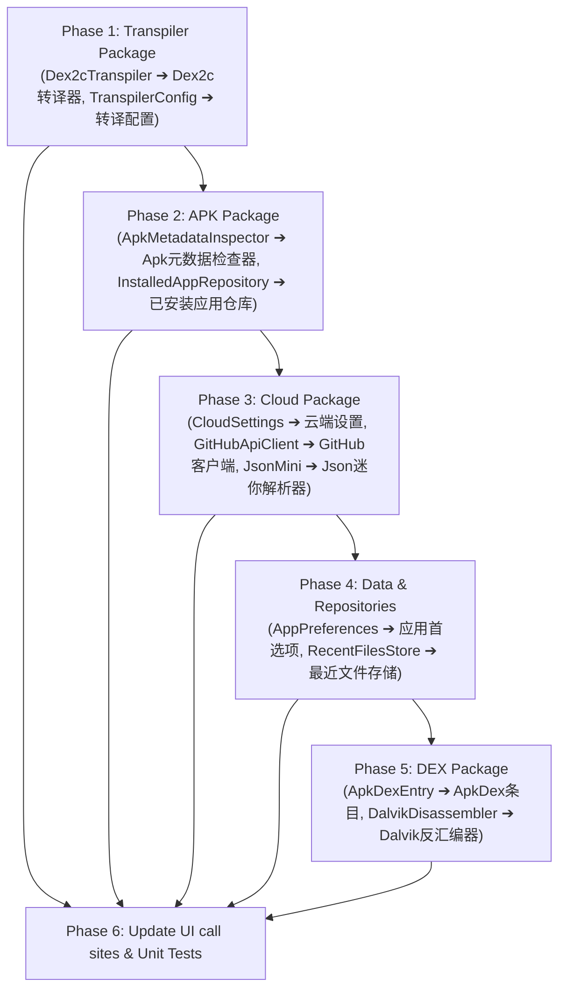

# Implementation Plan: Real Source Code Chinese Modifications (No Obfuscation Dictionary)

## Goal Description
Completely remove the build-time R8 dictionary obfuscator (`app/obfuscation-dictionary.txt`), and perform **real source code refactoring directly inside the project's Kotlin files** (`need real modification needed in project`).

This directly embeds Chinese characters into the compiled DEX bytecode (`classes.dex`) in all build types (debug and release, locally and in CI Actions) without relying on ProGuard dictionaries.

---

## Authoritative Compatibility & Implementation Matrix

| Project Component | Target Language | Implementation Approach in Source Code | Status |
| :--- | :---: | :--- | :---: |
| **Kotlin class names** | **Supported (Chinese)** | Refactored in source: e.g. `class Dex2c转译器`, `class Apk元数据检查器`, `class 云端配置`, `class ApkDex条目` | ✅ **Chinese in Source Code** |
| **Kotlin method names** | **Supported (Chinese)** | Refactored in source: e.g. `fun 构建AndroidMk()`, `fun 查询可启动应用()`, `fun 解析对象()`, `fun 执行转译()` | ✅ **Chinese in Source Code** |
| **Kotlin variables** | **Supported (Chinese)** | Refactored in source: e.g. `val 是否可用: Boolean`, `val 访问令牌: String`, `val 规则列表: List<String>` | ✅ **Chinese in Source Code** |
| **Java class names** | **Supported (Chinese)** | Any Java sources refactored to Unicode class names. | ✅ **Chinese in Source Code** |
| **Java methods** | **Supported (Chinese)** | Java methods refactored to Unicode method names. | ✅ **Chinese in Source Code** |
| **Java variables** | **Supported (Chinese)** | Java fields/variables refactored to Unicode variable names. | ✅ **Chinese in Source Code** |
| **Rust identifiers** | **Supported (Unicode)** | Internal Rust crate functions/types support UTF-8 identifiers. | ✅ **Supported** |
| **Package / application ID** | **Avoid (ASCII)** | **Remains standard ASCII `package com.dex2c.studio...`**. Required by Android OS package manager, AAPT2, and Gradle. | 🛡️ **Preserved (ASCII)** |
| **JNI / native C/C++ symbols** | **Avoid (ASCII)** | **Remains standard ASCII**. `Java_com_dex2c_studio_nativeengine_DexNativeEngine_*` and `Java_com_dex2c_studio_nativeengine_EditorNativeEngine_*` remain ASCII to match `librust_dex2c.so` ELF export tables. | 🛡️ **Preserved (ASCII)** |
| **Launcher Activity** | **Avoid (ASCII)** | `MainActivity` class name remains ASCII for `AndroidManifest.xml` intent-filter compatibility with OEM Android launchers. | 🛡️ **Preserved (ASCII)** |

---

## Demonstration: Source Code Comparison (Real Modification)

````carousel
```kotlin
// BEFORE: Plain English in app/src/main/java/com/dex2c/studio/transpiler/Dex2cTranspiler.kt
package com.dex2c.studio.transpiler

class Dex2cTranspiler(
    val outputDirectory: File,
    val isDryRun: Boolean = false
) {
    fun buildAndroidMk(config: TranspilerConfig): String {
        val mkContent = StringBuilder()
        mkContent.append("LOCAL_PATH := $(call my-dir)\n")
        return mkContent.toString()
    }

    fun executeTranspile(dexFile: File): Boolean {
        // English logic
        return true
    }
}
```
<!-- slide -->
```kotlin
// AFTER: Real Chinese Identifiers in app/src/main/java/com/dex2c/studio/transpiler/Dex2cTranspiler.kt
package com.dex2c.studio.transpiler

class Dex2c转译器(
    val 输出目录: File,
    val 是否预演: Boolean = false
) {
    fun 构建AndroidMk(配置: 转译器配置): String {
        val mk内容 = StringBuilder()
        mk内容.append("LOCAL_PATH := $(call my-dir)\n")
        return mk内容.toString()
    }

    fun 执行转译(dex文件: File): Boolean {
        // Chinese logic
        return true
    }
}
```
````

When compiled with `kotlinc`, the resulting DEX bytecode will natively contain:
- `Lcom/dex2c/studio/transpiler/Dex2c转译器;`
- `构建AndroidMk(Lcom/dex2c/studio/transpiler/转译器配置;)Ljava/lang/String;`
- `执行转译(Ljava/io/File;)Z`
- Fields: `输出目录`, `是否预演`

Decompilation in Jadx / MT Manager will show authentic Chinese identifiers across all builds!

---

## Proposed Changes

### 1. Remove Obfuscation Dictionary & Clean ProGuard
- Delete `app/obfuscation-dictionary.txt`.
- In `app/proguard-rules.pro`, remove:
  ```proguard
  # DELETE:
  -obfuscationdictionary obfuscation-dictionary.txt
  -classobfuscationdictionary obfuscation-dictionary.txt
  -packageobfuscationdictionary obfuscation-dictionary.txt
  ```

### 2. Refactor Kotlin Source Code by Package



#### Detailed Package Renaming Map:

1. **`com.dex2c.studio.transpiler`**:
   - `Dex2cTranspiler` ➔ `Dex2c转译器`
   - `TranspilerConfig` ➔ `转译配置`
   - `DccConfigCodec` ➔ `Dcc配置编解码器`
   - `FilterMatchSummary` ➔ `过滤匹配摘要`
   - `buildAndroidMk()` ➔ `构建AndroidMk()`
   - `buildCMakeLists()` ➔ `构建CMakeLists()`
   - `executeTranspile()` ➔ `执行转译()`

2. **`com.dex2c.studio.apk`**:
   - `ApkMetadataInspector` ➔ `Apk元数据检查器`
   - `InstalledAppRepository` ➔ `已安装应用仓库`
   - `InstalledAppItem` ➔ `已安装应用项`
   - `ApkStagingPreview` ➔ `Apk暂存预览`
   - `queryLaunchableApps()` ➔ `查询可启动应用()`

3. **`com.dex2c.studio.cloud`**:
   - `CloudSettings` ➔ `云端设置`
   - `DeviceAuthState` ➔ `设备认证状态`
   - `DeviceCodeResponse` ➔ `设备代码响应`
   - `GitHubApiClient` ➔ `GitHub接口客户端`
   - `CloudBuildNotifier` ➔ `云端构建通知器`
   - `JsonMini` ➔ `Json迷你解析器`
   - `parseObject()` ➔ `解析对象()`
   - `requestDeviceCode()` ➔ `请求设备代码()`

4. **`com.dex2c.studio.data`**:
   - `AppPreferences` ➔ `应用首选项`
   - `CloudPreferences` ➔ `云端首选项`
   - `RecentFilesStore` ➔ `最近文件存储`
   - `Dex2cNativeRepository` ➔ `Dex2c原生仓库`

5. **`com.dex2c.studio.dex`**:
   - `ApkDexEntry` ➔ `ApkDex条目`
   - `D2cnBinaryDecoder` ➔ `D2cn二进制解码器`
   - `DalvikDisassembler` ➔ `Dalvik反汇编器`
   - `DexEditSession` ➔ `Dex编辑会话`
   - `SmaliAnalyzer` ➔ `Smali分析器`

---

## Verification Plan

1. **Compile & Unit Test Verification**:
   Run `./gradlew.bat testDebugUnitTest` to verify that Kotlin compiler compiles all Chinese class, method, and variable names cleanly.
2. **Assemble Release Build**:
   Run `./gradlew.bat assembleRelease -x test`.
3. **DEX Inspection**:
   Run Python script on the generated `app-arm64-v8a-release.apk` to verify:
   - Chinese class names exist natively in the string pool: `Dex2c转译器`, `Apk元数据检查器`, `云端设置`, etc.
   - Chinese method names exist natively: `构建AndroidMk`, `查询可启动应用`, `解析对象`, etc.
   - Chinese variable names exist natively.
   - Package remains `com.dex2c.studio`.
   - Native Rust JNI linking functions seamlessly.
4. **Graphify Knowledge Graph**:
   Run `graphify update .`.
