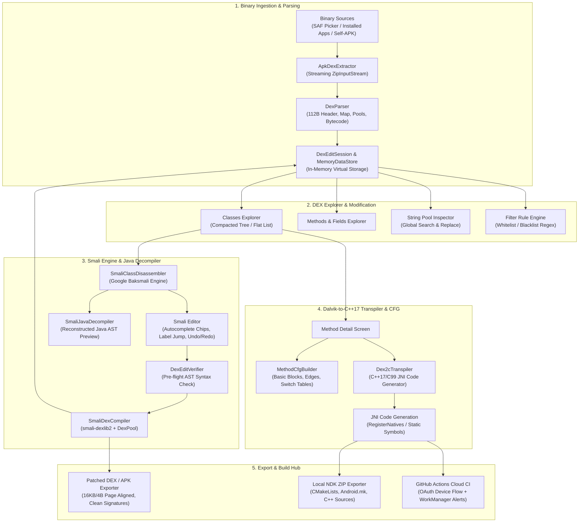
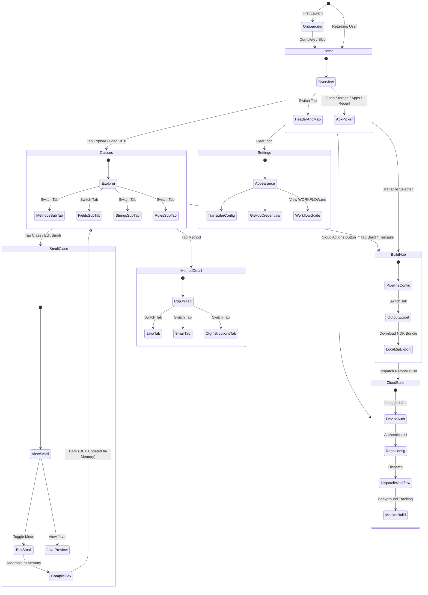
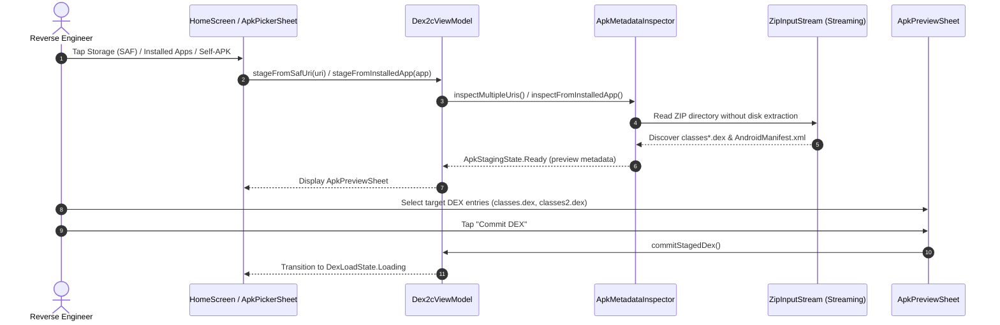
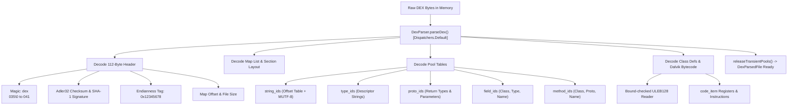
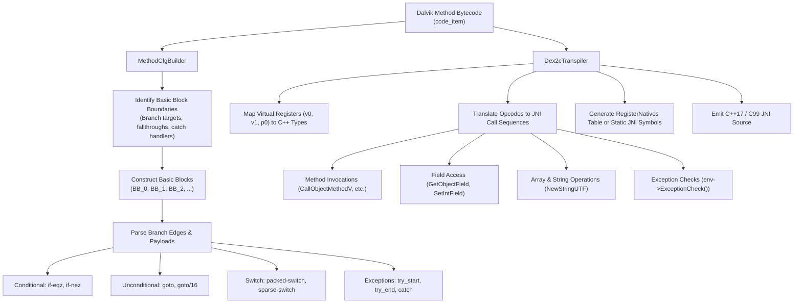
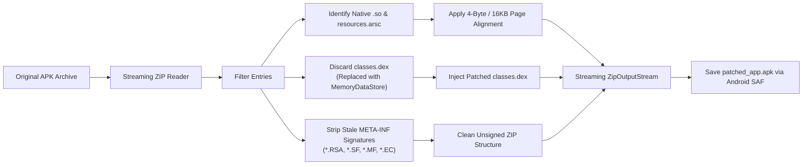
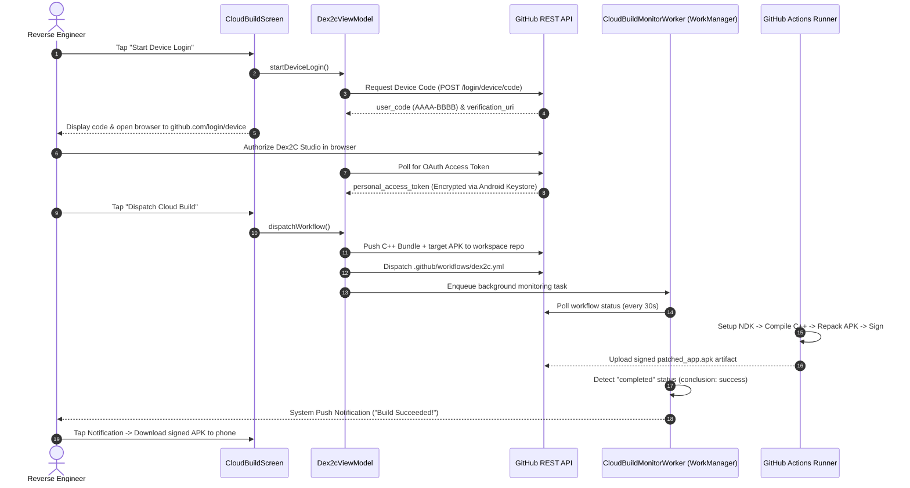

# Dex2C Studio — Comprehensive Application Workflow & Usages Blueprint

## Overview

**Dex2C Studio** (`com.dex2c.studio`) is an all-in-one Android on-device Dalvik bytecode analyzer, in-memory Smali editor, Java decompiler, Dalvik-to-C++17/C99 JNI native transpiler, and GitHub Actions Cloud CI orchestrator.

The application is engineered to operate **100% in memory** using streaming ZIP/DEX extractors, random-access virtual data stores (`MemoryDataStore`), and bounded LRU caches to ensure zero disk leaks, zero residual temporary files, and optimal memory management on mobile devices.

---

## 1. High-Level System Architecture & In-Memory Data Pipeline

The diagram below illustrates the end-to-end data pipeline from binary ingestion through exploration, in-memory modification, native transpilation, and binary export:



---

## 2. User Navigation & Screen State Machine

The application is structured into 8 interconnected screens and bottom-sheet dialogs powered by Jetpack Compose and Navigation Compose:



---

## 3. Deep-Dive Operational Workflows (Step-by-Step)

### Phase 1: Binary Selection & Multi-DEX Staging

When a user initiates binary inspection, Dex2C Studio protects device resources by inspecting archives in a streaming fashion before loading raw bytecode into memory.



#### Detailed Operational Steps:
1. **Source Selection Pathways**:
   - **Device Storage (SAF Picker)**: Prompts Android's system document picker (`ActivityResultContracts.OpenDocument`). Calls `contentResolver.takePersistableUriPermission()` so permissions survive process recreation.
   - **Installed Applications**: Queries Android `PackageManager` via `InstalledAppRepository` on `Dispatchers.IO`, loading application icons, labels, package names, version names, and APK file paths (`sourceDir`).
   - **Self-APK Inspection**: Points directly to Dex2C Studio's own live APK binary (`context.applicationInfo.sourceDir`), providing immediate inspection without needing external files.
   - **Recent Binaries History**: Uses `RecentFilesStore` to restore recently analyzed files with source type badges (`STORAGE`, `APPS`).
2. **Streaming Pre-flight Inspection**:
   - `ApkMetadataInspector` uses streaming `ZipInputStream` to discover all `classes*.dex` entries and parse binary XML `AndroidManifest.xml` to resolve package name and version without unpacking to disk.
3. **Interactive Staging Sheet (`ApkPreviewSheet`)**:
   - Displays total APK size, package name, and a list of all DEX entries.
   - User chooses which DEX entries to parse (defaults to primary `classes.dex`, or multi-DEX selection).
   - Tapping **Commit DEX** triggers background parsing.

---

### Phase 2: In-Memory DEX Parsing & Header Audit



#### Detailed Operational Steps:
1. **Parallel Multi-DEX Parsing**:
   - When multiple DEX files are committed, parsing executes concurrently on `Dispatchers.Default` using `async { ... }.awaitAll()`.
2. **112-Byte Header Decoding**:
   - Validates DEX magic (`035` through `041`).
   - Reads Adler32 checksum and 20-byte SHA-1 signature.
   - Verifies endianness (`0x12345678`).
   - Reads `map_off` to map out the physical structure of the DEX binary.
3. **Pool Decoding with Bound-Checked Decoders**:
   - Decodes strings, types, prototypes, fields, and method signatures.
   - Dalvik bytecode payloads (`code_item`) are decoded with bound-checked ULEB128 decoders (`DexParser.readUleb128()`), preventing infinite loops on obfuscated or malformed bytecode.
4. **Transient Pool Cleanup**:
   - Calls `.releaseTransientPools()` to immediately free temporary raw byte arrays once high-level metadata is indexed, preserving RAM.

---

### Phase 3: DEX Explorer, Global Search & Constant Inspection

The **Classes Screen** organizes bytecode exploration into five dedicated sub-tabs:

1. **CLASSES Sub-tab (`EXPLORER`)**:
   - **Compacted Package Tree**: Automatically compacts single-child package directories (e.g. `com.example.security.auth` displays as a single consolidated branch).
   - **Flat Class List**: Lists all class descriptors alphabetically (`Lcom/example/MyClass;`).
   - **Filter Chips**:
     - `Hide Framework`: Excludes `android.*`, `androidx.*`, `kotlin.*`, `java.*`.
     - `Only Bytecode`: Hides interface stubs and abstract definitions without executable bytecode.
     - `Selected`: Shows only classes marked for C++ transpilation.
     - `Rules`: Shows classes matching active `filter.txt` rules.
   - **Select Mode**: Enables batch selection for transpilation, one-tap whitelist (`+W`), blacklist (`!B`), or class deletion.
2. **METHODS Sub-tab**:
   - Search across all method signatures in the active DEX (`Lpkg/Class;->method(ArgTypes)ReturnType`).
   - Filter by access flags (`public`, `private`, `static`, `native`, `final`, `synchronized`).
   - Tapping any method jumps directly to the Method Detail Screen.
3. **FIELDS Sub-tab**:
   - Search static and instance fields by name, declaring class, or type descriptor (`I`, `Z`, `Ljava/lang/String;`).
4. **STRINGS Sub-tab**:
   - Inspect the entire DEX string constant pool (`string_ids`).
   - Search for hardcoded API URLs, secrets, or encryption keys.
   - **Global Search & Replace**: Tap Replace, enter target string and replacement, and confirm. Executes in-memory string substitution across the entire DEX.
5. **RULES Sub-tab (`FILTER_RULES`)**:
   - Visual rule builder for Whitelist (`+W`) and Blacklist (`!B`) regex rules with live match count calculation.
   - Raw `filter.txt` editor supporting direct regex syntax (`com/example/auth/.*;.*`).

---

### Phase 4: Interactive Smali Disassembly, Editing & In-Memory DEX Assembly

When a user taps any class in the Explorer, the **Smali Class Screen** opens. The read-modify-verify-assemble loop is executed entirely in memory:

```mermaid
flowchart LR
    A["Active Class Def<br/>in Memory"] --> B["SmaliClassDisassembler<br/>(Google Baksmali)"]
    B --> C["Syntax-Highlighted<br/>Smali Viewer"]
    C --> D["User Toggles Edit Mode<br/>& Modifies Instructions"]
    D --> E["DexEditVerifier<br/>(Pre-flight Syntax Validation)"]
    E -- Syntax Invalid --> D
    E -- Syntax Valid --> F["SmaliDexCompiler<br/>(smali-dexlib2 AST)"]
    F --> G["DexPool Rebuild"]
    G --> H["MemoryDataStore<br/>(Random-Access Buffer)"]
    H --> I["Updated DEX Bytes<br/>Committed to Session"]
    I --> J["Session Undo Buffer<br/>(Rollback Guard)"]
```



#### Detailed Operational Steps:
1. **View Mode (Disassembly)**:
   - `SmaliClassDisassembler` uses Google's `baksmali` to disassemble `DexBackedClassDef` into structured Smali lines.
   - Syntax-highlights opcodes, registers (`v0`–`v15`, `p0`–`p4`), class types, and comments.
   - Collapsible method spans allow collapsing long methods to view class structure cleanly.
   - **Interactive Label Jump**: Tap any branch target (`:cond_0`, `:goto_1`, `:try_start_0`) to scroll directly to the target label.
2. **Edit Mode (Live Editor)**:
   - Line-by-line editor with persistent line numbers.
   - **Auto-Complete Chips**: Contextually suggests Dalvik opcodes, registers, and descriptors as the user types.
   - Multi-step **Undo / Redo** buffer.
   - Search & Replace within the active class.
3. **Assemble DEX (Compilation)**:
   - User taps **"Assemble DEX"**.
   - `DexEditVerifier` validates Smali syntax before compiling.
   - `SmaliDexCompiler` runs `smaliFlexLexer`, `smaliParser`, and `smaliTreeWalker` to assemble modified Smali into a `DexPool`.
   - Uses `MemoryDataStore` (random-access expandable byte buffer) to write out the modified DEX binary in memory.
   - `Dex2cViewModel` updates the active session with the new DEX bytes and refreshed parsed model. Session undo buffer preserves previous bytes in case of user rollback.
4. **Java Mode (Decompiler Preview)**:
   - `SmaliJavaDecompiler` reconstructs readable Java source code from the Smali instructions, including package declarations, class headers, fields, and control flow structures.

---

### Phase 5: Dalvik Control Flow Graph (CFG) & C++17 Transpiler

Tapping any method opens the **Method Detail Screen**, which provides deep structural inspection:



#### Detailed Operational Steps:
1. **C++17 / JNI Transpiler Tab**:
   - Shows the generated native C++ function corresponding to the Dalvik method.
   - Translates Dalvik virtual registers into typed C++ variables (`jobject`, `jint`, `jlong`, `jboolean`).
   - Generates JNI call equivalents (`env->CallObjectMethod`, `env->GetFieldID`, `env->NewStringUTF`).
   - Injects JNI exception checking (`if (env->ExceptionCheck()) return ...`).
   - Dynamic `RegisterNatives` mapping table or static JNI symbol (`Java_package_Class_method`).
2. **Java Tab**:
   - Reconstructed Java statement preview of the isolated method.
3. **Smali Tab**:
   - Syntax-highlighted Smali disassembly for the specific method.
4. **CFG & Instructions Tab**:
   - Decoded Dalvik instructions with instruction offsets and hex opcodes.
   - **Control Flow Graph (CFG)**:
     - Basic Blocks (`BB_0`, `BB_1`, ...).
     - Conditional and unconditional branch edges.
     - Switch payload analysis (`packed-switch`, `sparse-switch`) with jump targets.
     - Try/catch exception handler boundary mappings.

---

### Phase 6: Build Hub (Pipeline Configuration & Local NDK Export)

The **Build Hub** configures how transpilation occurs and generates standalone build systems:

1. **Pipeline Configuration (`PIPELINE` Tab)**:
   - **JNI Binding Style**: Choose `RegisterNatives` (`JNI_OnLoad` dynamic registration) or Static Symbols.
   - **C/C++ Dialect**: Toggle between `C++17 (env->)` and `C99 ((*env)->)`.
   - **Constructor Support (`--allow-init`)**: Allow transpiling `<init>` constructors into native init routines.
   - **Target ABIs**: Select architectures: `arm64-v8a`, `armeabi-v7a`, `x86_64`, `x86`.
   - **Module Name & Loader**: Configure native library name (`libdex2c.so`) and Java loader class name.
2. **Generated Output Preview & ZIP Export (`OUTPUT` Tab)**:
   - Previews generated files:
     - `dex2c_generated.cpp` & `dex2c_generated.h`
     - `CMakeLists.txt` & `Android.mk` / `Application.mk`
     - `dcc.cfg` & `filter.txt`
   - **Export ZIP**: `ZipBundleExporter` bundles all files into a ready-to-compile NDK project `.zip` and prompts the user to save it via SAF.

---

### Phase 7: Patched DEX & 16KB-Aligned APK Repackaging

When the user chooses to export a modified binary from the Classes menu:



#### Detailed Operational Steps:
1. **Export Patched DEX**:
   - Exports the currently modified in-memory DEX bytes as `patched_classes.dex` via Android SAF.
2. **Export Patched APK**:
   - `SmaliDexCompiler.repackageApkWithModifiedDex` replaces the modified `classes.dex` inside the original APK.
   - **Stripping Stale Signatures**: Removes all obsolete cryptographic signature files (`META-INF/*.RSA`, `*.DSA`, `*.EC`, `*.SF`, `*.MF`) so the modified APK can be re-signed cleanly without signature mismatch errors.
   - **16KB Page Alignment**: Aligns uncompressed `.so` native libraries and `resources.arsc` to 4-byte / 16KB page boundaries complying with Android 15/16 NDK requirements.
   - Saves `patched_app.apk` via Android SAF.

---

### Phase 8: Zero-NDK Remote Cloud CI via GitHub Actions

For mobile users who do not have a development PC or local Android NDK:



#### Detailed Operational Steps:
1. **GitHub OAuth Device Flow**:
   - User opens **Cloud Build** screen and taps "Start Device Login".
   - GitHub Device Flow issues an 8-character user code (`AAAA-BBBB`) and verification URL (`github.com/login/device`).
   - User authorizes in mobile browser; the app polls and receives a personal OAuth token.
   - Token is encrypted with AES-256-GCM via Android Keystore (`TokenEncryptor`).
2. **Automated Repository Setup**:
   - App checks or creates a private repository (e.g. `dex2c-workspace`).
   - Automatically commits the GitHub Actions workflow file: `.github/workflows/dex2c.yml`.
3. **Build Dispatch & Background Monitoring**:
   - App dispatches the workflow with the generated C++ bundle and target APK.
   - `CloudBuildMonitorWorker` (`WorkManager`) polls build progress every 30 seconds with exponential backoff.
   - Even if the app is killed or device reboots, `WorkManager` continues tracking.
4. **Completion Alert & Artifact Download**:
   - System push notification alerts user when the NDK compilation finishes.
   - Tapping notification deep-links to Cloud Build screen to download the compiled, signed, patched APK directly to the phone.

---

## 4. Real-World Practical Usage Recipes

### Recipe 1: Triage & Audit an Unknown Commercial APK
*Goal*: Inspect an unknown APK on an Android device to audit packages, check DEX versions, find hardcoded secrets, and inspect obfuscation levels.
1. Tap **Storage** on the Home screen -> select the downloaded `.apk`.
2. Inspect the **Staging Sheet**: notice multiple DEX files (`classes.dex`, `classes2.dex`, `classes3.dex`). Select `classes.dex` and tap **Commit DEX**.
3. On Home **Overview**, review total classes, methods, and file size. Switch to **Header & Map** to verify DEX version (`035` vs `038` vs `039`).
4. Navigate to **Classes** -> **STRINGS** tab. Search for sensitive terms: `https://`, `api_key`, `secret`, `bearer`, `admin`.
5. Switch to **METHODS** tab. Filter by `native` to identify existing JNI libraries.

---

### Recipe 2: Live In-Memory Smali Patching of a License / Root Check
*Goal*: Modify an integrity verification method in-memory, reassemble the DEX, and export a patched APK without using a computer.
1. Load the target APK in Dex2C Studio.
2. In **Classes** search, locate `com.target.security.IntegrityCheck`.
3. Tap the class to open **Smali Class Screen**.
4. In View Mode, find method `public isDeviceRooted()Z`.
5. Tap the **Edit** toggle button in the top bar.
6. Replace the method body with:
   ```smali
   .method public isDeviceRooted()Z
       .registers 2
       const/4 v0, 0x0
       return v0
   .end method
   ```
7. Tap **Assemble DEX**. The syntax is verified, assembled with `smali-dexlib2`, and committed to memory.
8. Return to Classes -> open the top menu -> tap **Export Patched APK**.
9. Sign the exported APK using any on-device signer (e.g., zSign) and install.

---

### Recipe 3: Mass String Substitution (Global API / URL Redirection)
*Goal*: Redirect all backend API calls to a local proxy or staging server across the entire DEX.
1. Load the APK in Dex2C Studio.
2. Go to **Classes** -> **STRINGS** tab.
3. In the search box, enter the production URL: `https://api.prod.example.com`.
4. Tap the **Replace** button.
5. In the replacement dialog, enter the new URL: `https://proxy.internal.dev`.
6. Confirm the replacement. The engine replaces all occurrences across string descriptors in memory.
7. Export the modified DEX or repackaged APK via the top bar menu.

---

### Recipe 4: Protecting Sensitive Algorithms via Dalvik-to-C++17 Transpilation
*Goal*: Convert critical business logic or cryptographic methods from Java bytecode into compiled C++ native code to resist reverse engineering.
1. Load the APK or DEX file.
2. Go to **Classes** screen and enable **Select Mode**.
3. Select the classes or methods containing sensitive algorithms (e.g., encryption routines, token generators).
4. Tap the **Rules** tab or tap **+W** to ensure these methods are included in the whitelist.
5. Tap **Build / Transpile** to open the **Build Hub**.
6. In **Pipeline Config**:
   - Set JNI Binding to `RegisterNatives` (dynamic binding without exported symbol names).
   - Select `C++17 (env->)`.
   - Select target ABIs: `arm64-v8a` and `armeabi-v7a`.
7. Switch to the **Output Tab** to preview the generated `dex2c_generated.cpp` and `CMakeLists.txt`.
8. Tap **Export ZIP** to download the C++ bundle for local NDK compilation, or navigate to **Cloud Build** to build remotely via GitHub Actions.

---

### Recipe 5: Analyzing Complex Obfuscated Control Flow with CFG
*Goal*: De-obfuscate a method containing complex jumps, exception handlers, and switch tables.
1. In the Classes explorer, tap the target method to open **Method Detail Screen**.
2. Tap the **CFG & Instructions** tab.
3. Review the **Control Flow Graph**:
   - Each Basic Block (`BB_0`, `BB_1`, ...) shows starting instruction offsets, instructions within the block, and branch exits.
   - Branch edges clearly demarcate conditional jumps (`if-eqz`, `if-nez`) and unconditional jumps (`goto`).
   - Switch payloads (`packed-switch-payload`, `sparse-switch-payload`) display all case keys and relative branch targets.
   - Try-catch handler ranges display exact boundary blocks.
4. Compare this against the reconstructed **Java** tab and the transpiled **C++17** tab for complete structural clarity.

---

### Recipe 6: Zero-NDK Cloud Build Pipeline via GitHub Actions
*Goal*: Compile C++ sources into `.so` native libraries and produce a ready-to-install APK on a low-spec mobile device without Android NDK or a PC.
1. Complete method selection and pipeline configuration in **Build Hub**.
2. Tap **Cloud Build** in the navigation bar.
3. If not already authenticated, complete the 10-second GitHub OAuth Device Login.
4. Configure your private build repository (the app automatically sets up `.github/workflows/dex2c.yml`).
5. Tap **Dispatch Cloud Build**.
6. The app monitors the GitHub Actions workflow in the background. You can safely minimize or close the app.
7. When the NDK build finishes, tap the system notification to download the signed, patched APK containing the compiled native libraries.

---

## 5. Performance & Memory Safeguards Summary

| Subsystem | Safeguard Architecture |
| :--- | :--- |
| **ZIP Ingestion** | Streaming `ZipInputStream` without temporary file extraction to disk. |
| **DEX Parsing** | Concurrent background decoding (`Dispatchers.Default`) with bound-checked ULEB128 iteration bounds. |
| **Transient Memory** | `.releaseTransientPools()` discards raw byte buffers once metadata indexing is complete. |
| **Smali Compilation** | Direct `smali-dexlib2` AST assembly into `DexPool` via `MemoryDataStore` without spawning CLI tools. |
| **Session Rollback** | Preserves `previousDexBytes: ByteArray?` before writes, enabling instant recovery on errors. |
| **LRU Caches** | Bounded caches for Smali disassembly, Java decompilation, and CFGs that auto-trim on screen navigation or OS memory pressure (`ComponentCallbacks2.onTrimMemory`). |
| **APK Repacking** | Automatically strips stale `META-INF` cryptographic signatures and applies 16KB/4-byte page alignment to `.so` libraries and `resources.arsc` for Android 15/16 compliance. |
