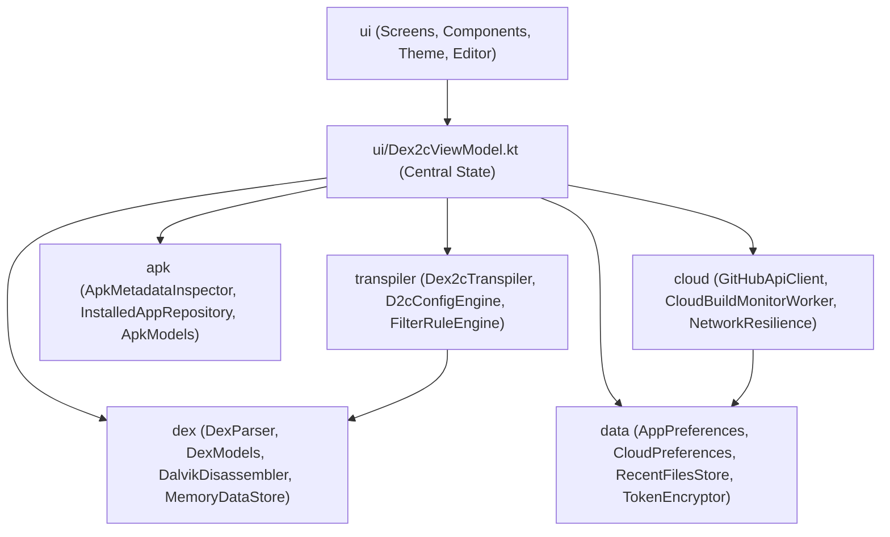

# Complete Codebase Audit: Dex2C Studio (`com.dex2c.studio`)

## 1. Executive Summary & Project Inventory

Dex2C Studio is an on-device Android Dalvik bytecode analyzer, in-memory Smali editor, Java AST previewer, Dalvik-to-C++17/C99 JNI transpiler, and GitHub Actions Cloud CI orchestrator.
The project is built on modern Android toolchains (compileSdk 37, minSdk 24, targetSdk 36, Kotlin 2.x, Jetpack Compose Material 3, Sora Editor, Baksmali, and OkHttp).

### 1.1 Repository Inventory & Metrics
- **Total Kotlin Source Files**: 71 main source files (`app/src/main/java`) + 17 test files (`app/src/test/java`).
- **Total Lines of Source Code**: ~24,500 lines of production Kotlin code.
- **Architectural Style**: Single-module Android application (`:app`) organized into domain packages: `apk`, `cloud`, `data`, `dex`, `transpiler`, and `ui` (screens, components, editor, theme).
- **Core Abstractions**:
  - `Dex2cViewModel` (3,062 lines) — Central state holder and coordinator.
  - `MainActivity` (1,192 lines) — Single Activity host, edge-to-edge window configuration, and NavHost.
  - `DexParser` (719 lines) — Pure Kotlin / ByteBuffer Dalvik DEX parser.
  - `Dex2cTranspiler` (1,280 lines) — C++17/C99 JNI transpilation code generator.
  - `SmaliClassDisassembler` (470 lines) — Baksmali integration and class structure extractor.
  - `SmaliSoraEditor` (259 lines) — Rosemoe Sora CodeEditor integration with TextMate grammar.

---

## 2. Package & Module Architecture Map

### 2.1 Package Breakdown
1. **`com.dex2c.studio`**
   - `MainActivity.kt`: Android ComponentActivity, system bar styling, top-level navigation, deep-link handling.
2. **`com.dex2c.studio.apk`**
   - `ApkMetadataInspector.kt`: Reads APK manifests, certificates, package names, version codes via Zip/PackageManager.
   - `ApkModels.kt`: Data models (`InstalledAppItem`, `ApkStagingPreview`, `RecentBinaryItem`).
   - `InstalledAppRepository.kt`: Queries launchable apps via PackageManager, caches icons, extracts sourceDirs.
3. **`com.dex2c.studio.cloud`**
   - `GitHubApiClient.kt`: GitHub OAuth Device Flow, REST API client (runs, workflows, jobs, artifacts, zipball).
   - `CloudBuildMonitorWorker.kt`: AndroidX WorkManager CoroutineWorker for background build polling and alerts.
   - `CloudBuildNotifier.kt`: NotificationManager wrapper for live progress and completion notifications.
   - `CloudModels.kt`: DTOs (`DeviceCodeResponse`, `GitHubWorkflowRunSummary`, `GitHubArtifactItem`).
   - `Dex2cWorkflowGenerator.kt`: Generates `.github/workflows/dex2c-build.yml` with NDK r25b/r26b matrix.
   - `NetworkResilience.kt`: Resilient DNS lookup with DoH (1.1.1.1 / 8.8.8.8) fallback and transient retry.
   - `JsonMini.kt`: Lightweight zero-dependency JSON parser.
4. **`com.dex2c.studio.data`**
   - `AppPreferences.kt`: DataStore Preferences for theme, typography, line numbers, and accent color.
   - `CloudPreferences.kt`: DataStore Preferences for encrypted tokens, GitHub owner/repo, poll intervals.
   - `TranspilerPreferences.kt`: Transpiler configurations, loader flags, and filter rules text.
   - `RecentFilesStore.kt`: Recent binary MRU list and last bytecode summary.
   - `TokenEncryptor.kt`: AES-GCM Android KeyStore encryption for GitHub access tokens.
5. **`com.dex2c.studio.dex`**
   - `DexParser.kt`: Low-level DEX 035-041 header, strings, types, protos, fields, methods, annotations parser.
   - `DexModels.kt`: DEX data structures (`DexClassInfo`, `DexEncodedMethod`, `DalvikInstruction`, `DexCodeMeta`).
   - `DalvikDisassembler.kt`: Instruction decoding and Dalvik bytecode formatting.
   - `SmaliClassDisassembler.kt`: Google Baksmali wrapper for full-class disassembly and method span indexing.
   - `SmaliDexCompiler.kt`: smali-dexlib2 / DexPool compiler assembling edited Smali back into DEX bytes.
   - `SmaliEditorEngine.kt`: Smali symbol completion suggestions, label jumps, and bytecode AST helpers.
   - `DexEditSession.kt`: Session-scoped undo/redo stack for modified DEX binaries.
   - `DexEditVerifier.kt`: Pre-flight sanity checks on edited Smali instructions before compilation.
   - `DalvikControlFlowGraph.kt`: Basic blocks, edges, conditional branches, and exception catch blocks.
   - `MemoryDataStore.kt`: RandomAccessDataStore implementation operating 100% in JVM memory.
6. **`com.dex2c.studio.transpiler`**
   - `Dex2cTranspiler.kt`: Translates Dalvik bytecode to C++17/C99 JNI code with opcode-specific emitter routines.
   - `TranspilerModels.kt`: Configuration flags (`LoaderMode`, `TargetCLanguage`, `JniBindingStyle`).
   - `FilterRuleEngine.kt`: Regex and wildcard whitelist/blacklist rules engine (`filter.txt`).
   - `D2cConfigEngine.kt`: Parser and serializer for `dcc.cfg` pipeline parameters.
   - `ZipBundleExporter.kt`: Generates standalone native build packages with CMakeLists.txt and Android.mk.
7. **`com.dex2c.studio.ui`**
   - `AdaptiveLayout.kt`: WindowAdaptiveInfo calculations (compact, medium, expanded, landscape, two-pane).
   - `Dex2cViewModel.kt`: Central state holder managing DEX parsing, staging, transpiling, filtering, and cloud CI.
   - `screens/`: `HomeScreen`, `ClassesScreen`, `PipelineConfigScreen`, `CloudBuildScreen`, `MethodDetailScreen`, `SmaliClassScreen`, `SettingsScreen`, `SettingsSubScreens`, `OnboardingScreen`.
   - `components/`: Modular UI widgets (`ApkPickerSheet`, `ApkPreviewSheet`, `SmaliSoraEditor`, `CfgViewer`, etc.).
   - `editor/`: `SmaliEditorManager.kt` managing Rosemoe Sora Editor TextMate grammar registration.
   - `theme/`: Material 3 dynamic color theming, syntax palettes, and typography.

---

## 3. Dependency Injection & Service Initialization

- **Dependency Injection**: Dex2C Studio relies on Jetpack ViewModel factory instantiation (`androidx.lifecycle.viewmodel.compose.viewModel`) and explicit constructor parameter injection for testing (e.g. `GitHubApiClient` parameter in `Dex2cViewModel`).
- **Service Initialization**:
  - `SmaliEditorManager.ensureInitialized(context)` lazily loads TextMate grammars and syntax themes.
  - `CloudBuildNotifier.ensureNotificationChannel(context)` ensures Android O+ notification channels exist.
  - WorkManager schedules `CloudBuildMonitorWorker` using `ExistingWorkPolicy.REPLACE`.

---

## 4. Key Architectural Deficiencies & Technical Debt Identified

1. **God-Class Anti-Pattern**:
   - `Dex2cViewModel.kt` (3,062 lines) consolidates 8 distinct sub-domains: APK staging, installed apps, DEX parsing, Smali disassembling/compiling, method CFG analysis, transpiler orchestration, recent files, and GitHub CI polling.
2. **Recomposition Cascades**:
   - `MainActivity.kt` collects 25+ independent StateFlows at the root `Dex2cApp` level, invalidating the entire Compose tree whenever any leaf state (such as background polling progress or app search text) changes.
3. **Allocation Heavy Model Accessors**:
   - `DexClassInfo.allMethods` concatenates `directMethods + virtualMethods` into a new `ArrayList` on every property read.
4. **Unbounded Bitmap Lifecycle**:
   - `InstalledAppRepository` holds Bitmaps in an LruCache sized by count (64) rather than bytes, and leaks Bitmaps into the persistent ViewModel StateFlow.
5. **Keystroke Thread Churn**:
   - `SmaliSoraEditor.kt` transforms entire 50,000+ line documents into `String` on every single typed keystroke via `ContentChangeEvent`.
6. **Dead / Inaccessible UI Pathways**:
   - `SmaliClassScreen.kt` has empty TopAppBar actions, stranding `onCopySmali` and `onExportSmali` callbacks.
