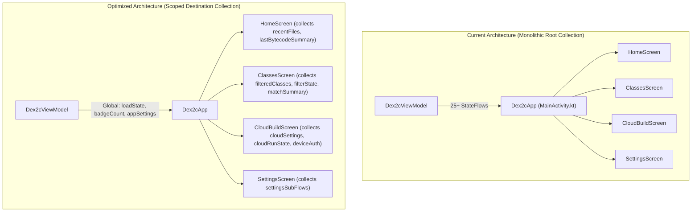

# State Management & Lifecycle Architecture Report: Dex2C Studio

## 1. Executive Summary

This report evaluates state ownership, reactivity, lifecycle integration, and concurrency control in **Dex2C Studio** (`com.dex2c.studio`).

### Key Findings
1. **Root-Level State Inundation**: Over 25 distinct `StateFlow` streams are exposed and collected directly within `Dex2cApp` in `MainActivity.kt`.
2. **State Sharing Semantics**: `SharingStarted.WhileSubscribed(5_000)` is correctly utilized for DataStore-backed preferences, ensuring background collections stop 5 seconds after all composables unbind.
3. **Complex Derived Flows**: `filteredClasses` combines `_loadState`, `_filterState`, `_selectedMethodIds`, and `filterMatchSummary`. In large DEX files with 10,000+ classes, selection toggles should avoid re-evaluating the full filter predicate when filters are independent.
4. **Job Scoping & Cancellation**: Active asynchronous tasks (`bundleJob`, `smaliJob`, `devicePollJob`, `repoSetupJob`, `cloudRunPollJob`) are correctly tracked as `Job?` fields in `Dex2cViewModel` and cancelled prior to launching replacements.

---

## 2. State Ingestion & Recomposition Scoping

### 2.1 Recomposition Isolation Strategy
In `MainActivity.kt`:
- **Current State**:
  `Dex2cApp` declares `val filteredClasses by viewModel.filteredClasses.collectAsStateWithLifecycle()`, `val cloudRunState by ...`, etc.
  Whenever a background polling job ticks `cloudRunState`, `Dex2cApp` recomposes completely, re-invoking `BoxWithConstraints`, `Scaffold`, and `NavigationRail`.
- **Target State**:
  Move screen-specific collections down into the `composable(ROUTE_...)` lambda blocks. `Dex2cApp` only collects:
  1. `loadState` (needed for title and navigation interlocks).
  2. `selectedMethodIds` (only the `.size` is needed for the badged nav item; can be exposed as `val selectedCount: StateFlow<Int>`).
  3. `appSettings` and `appSettingsHydrated` (needed for theme and start destination).
  4. `statusBanner` and `dexEditUndoPrompt` (needed for the root `SnackbarHostState`).
  5. `isPickerOpen` (needed for modal sheets).

All other states (`filteredApps`, `filteredClasses`, `filterState`, `cloudSettings`, `deviceAuthState`, `cloudRunState`, `repoSetupState`, `recentCloudRuns`) are collected only within the screens that render them.

---

## 3. Concurrency & Asynchronous Flow Safety

1. **Job Cancellation**:
   - `Dex2cViewModel.disassembleClassSmali`: `smaliJob?.cancel()`. Cancels previous disassembly if user switches classes quickly.
   - `Dex2cViewModel.generateNativeBundle`: `bundleJob?.cancel()`. Prevents parallel bundle export races.
   - `Dex2cViewModel.startGitHubDeviceAuth`: `devicePollJob?.cancel()`. Prevents duplicate OAuth pollers.
2. **Dispatchers**:
   - Heavy parsing runs on `Dispatchers.Default` (e.g. `coroutineScope { chosenEntries.map { async(Dispatchers.Default) { DexParser.parseDex(...) } } }`).
   - File I/O runs on `Dispatchers.IO` (e.g. `withContext(Dispatchers.IO) { ApkMetadataInspector.inspectMultipleUris(...) }`).
3. **DataStore Preferences**:
   - All preferences updates use transactional `dataStore.edit { ... }` blocks, preventing partial state writes.

---

## 4. State Management Action Plan

1. Isolate destination state collections in `MainActivity.kt`.
2. Add derived `selectedMethodCount: StateFlow<Int>` in `Dex2cViewModel` so `NavigationRailItem` does not observe the full set of method ID strings.
3. Optimize cache key equality check in `filteredClasses` to avoid recalculating unchanged class lists.
