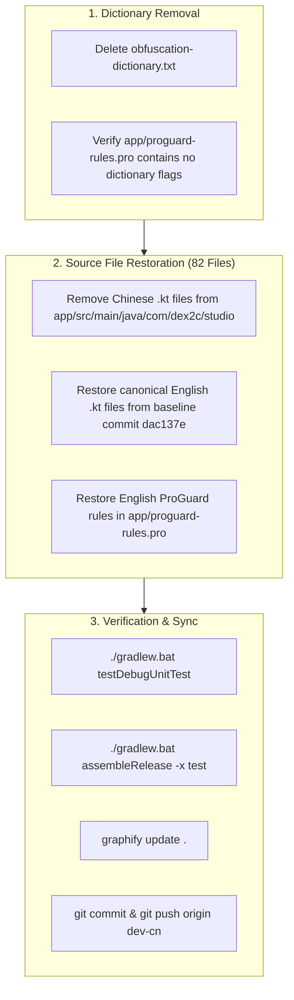

# Implementation Plan: Remove Dictionaries & Restore Entire Codebase to English Version

## Goal Description
The user requested:
> "remove dict & chinnese classname & all restore to english version."

This operation will:
1. **Remove Dictionaries**:
   - Permanently delete `obfuscation-dictionary.txt` from the repository root.
   - Verify `app/obfuscation-dictionary.txt` remains absent.
   - Ensure [app/proguard-rules.pro](file:///C:/Users/roni2/Downloads/Github-Projects/Dex2c-Android/app/proguard-rules.pro) has zero dictionary configuration directives (`-obfuscationdictionary`, `-classobfuscationdictionary`, `-packageobfuscationdictionary`).
2. **Remove Chinese Classnames & Methods**:
   - Revert all modified Kotlin classes, methods, and variables back to their standard English names (e.g. `Dex2c转译器` $\rightarrow$ `Dex2cTranspiler`, `转译器配置` $\rightarrow$ `TranspilerConfig`, `Apk元数据检查器` $\rightarrow$ `ApkMetadataInspector`, `已安装应用仓库` $\rightarrow$ `InstalledAppRepository`, `Json迷你解析器` $\rightarrow$ `JsonMini`, `最近文件存储` $\rightarrow$ `RecentFilesStore`, `令牌加密器` $\rightarrow$ `TokenEncryptor`, etc.).
3. **Restore All 82 Kotlin Files to English Filenames**:
   - Revert all 82 Chinese Kotlin source files across `app/src/main/java/com/dex2c/studio` back to their canonical English names (`MainActivity.kt`, `Dex2cTranspiler.kt`, `TranspilerModels.kt`, `D2cConfigEngine.kt`, `HomeScreen.kt`, etc.).
4. **Preserve Tools & Utilities**:
   - Preserve [scripts/delete_workflow_runs.py](file:///C:/Users/roni2/Downloads/Github-Projects/Dex2c-Android/scripts/delete_workflow_runs.py) for workflow management.
5. **Verify Full System**:
   - Execute `./gradlew.bat testDebugUnitTest` to ensure all unit tests pass with 0 failures.
   - Execute `./gradlew.bat assembleRelease -x test` to verify release APK builds cleanly.
   - Run `graphify update .` to synchronize the knowledge graph with the restored English codebase.

---

## User Review Required

> [!IMPORTANT]
> **Complete Restoration to English Source Baseline**:
> All Chinese identifiers and Chinese file names in `app/src/main/java/com/dex2c/studio` will be restored to their pre-Chinese state (commit `dac137e`), which represents the fully functional, clean English baseline where all cloud features, Rust editor tokenization, and architecture improvements are present and proven to build with 100% test success.

---

## Proposed Changes



### Component 1: Dictionary & ProGuard Rules

#### [DELETE] obfuscation-dictionary.txt
- Remove `obfuscation-dictionary.txt` from repository root via `git rm -f obfuscation-dictionary.txt`.

#### [MODIFY] [app/proguard-rules.pro](file:///C:/Users/roni2/Downloads/Github-Projects/Dex2c-Android/app/proguard-rules.pro)
- Revert the temporary Chinese preservation rules:
```diff
-# Preserve Dex2C application Chinese classes, methods, models, and data stores natively
--keep class com.dex2c.studio.** { *; }
--keepclassmembers class com.dex2c.studio.** { *; }
+# Preserve Dex2C application models, configurations, data stores and filters
+-keep class com.dex2c.studio.apk.** { *; }
+-keep class com.dex2c.studio.cloud.** { *; }
+-keep class com.dex2c.studio.data.** { *; }
+-keep class com.dex2c.studio.dex.** { *; }
+-keep class com.dex2c.studio.transpiler.** { *; }
```

---

### Component 2: Source Code Restoration (`app/src/main/java/com/dex2c/studio`)

All 82 files will be restored from baseline commit `dac137e`:

#### [RESTORE] `transpiler/` (4 files)
- `Dex2c转译器.kt` $\rightarrow$ `Dex2cTranspiler.kt` (Class: `Dex2cTranspiler`)
- `转译器模型.kt` $\rightarrow$ `TranspilerModels.kt` (Classes: `TranspilerConfig`, `TranspilerProgress`, `GeneratedFile`, `GeneratedPackage`, `FilterMatchSummary`)
- `D2c配置引擎.kt` $\rightarrow$ `D2cConfigEngine.kt` (Class: `D2cConfigEngine`)
- `Zip包导出器.kt` $\rightarrow$ `ZipExporter.kt` (Class: `ZipExporter`)

#### [RESTORE] `apk/` (3 files)
- `Apk元数据检查器.kt` $\rightarrow$ `ApkMetadataInspector.kt` (Class: `ApkMetadataInspector`)
- `Apk模型.kt` $\rightarrow$ `ApkModels.kt` (Classes: `InstalledAppItem`, `RecentBinaryItem`, `ApkStagedPreview`)
- `已安装应用仓库.kt` $\rightarrow$ `InstalledAppRepository.kt` (Class: `InstalledAppRepository`)

#### [RESTORE] `cloud/` (8 files)
- `云端模型.kt` $\rightarrow$ `CloudModels.kt` (Classes: `CloudSettings`, `DeviceCodeResponse`, etc.)
- `Json迷你解析器.kt` $\rightarrow$ `JsonMini.kt` (Class: `JsonMini`)
- `云端构建通知器.kt` $\rightarrow$ `CloudBuildNotifier.kt`
- `云端构建监听器.kt` $\rightarrow$ `CloudBuildMonitorWorker.kt`
- `云端命名规范.kt` $\rightarrow$ `CloudNamingConvention.kt`
- `Dex2c工作流生成器.kt` $\rightarrow$ `Dex2cWorkflowGenerator.kt`
- `GitHub接口客户端.kt` $\rightarrow$ `GitHubApiClient.kt`
- `网络弹性调度器.kt` $\rightarrow$ `NetworkResilience.kt`

#### [RESTORE] `data/` (7 files)
- `最近文件存储.kt` $\rightarrow$ `RecentFilesStore.kt` (Class: `RecentFilesStore`)
- `令牌加密器.kt` $\rightarrow$ `TokenEncryptor.kt` (Class: `TokenEncryptor`)
- `应用首选项.kt` $\rightarrow$ `AppPreferences.kt`
- `云端首选项.kt` $\rightarrow$ `CloudPreferences.kt`
- `转译器首选项.kt` $\rightarrow$ `TranspilerPreferences.kt`
- `应用图标管理器.kt` $\rightarrow$ `AppIconManager.kt`
- `data/repository/Dex2c原生仓库.kt` $\rightarrow$ `data/repository/Dex2cNativeRepository.kt`

#### [RESTORE] `dex/` (14 files)
- `Dex模型.kt` $\rightarrow$ `DexModels.kt` (Classes: `ApkDexEntry`, `DexParsedFile`, etc.)
- `Dalvik反汇编器.kt` $\rightarrow$ `DalvikDisassembler.kt` (Class: `DalvikDisassembler`)
- `D2cn二进制解码器.kt` $\rightarrow$ `D2cnBinaryDecoder.kt` (Class: `D2cnBinaryDecoder`)
- `D2cn头信息.kt` $\rightarrow$ `D2cnHeader.kt`
- `Dalvik控制流图.kt` $\rightarrow$ `DalvikControlFlowGraph.kt`
- `Dex编辑会话.kt` $\rightarrow$ `DexEditSession.kt`
- `Dex编辑校验器.kt` $\rightarrow$ `DexEditVerifier.kt`
- `Dex辅助工具.kt` $\rightarrow$ `DexUtils.kt`
- `Dex解析器.kt` $\rightarrow$ `DexParser.kt`
- `内存数据存储.kt` $\rightarrow$ `InMemoryDataStore.kt`
- `Smali类反汇编器.kt` $\rightarrow$ `SmaliDisassembler.kt`
- `Smali光标工具.kt` $\rightarrow$ `SmaliCursorUtil.kt`
- `SmaliDex编译器.kt` $\rightarrow$ `SmaliDexCompiler.kt`
- `Smali编辑引擎.kt` $\rightarrow$ `SmaliEditEngine.kt`

#### [RESTORE] `nativeengine/` (2 files)
- `Dex原生引擎.kt` $\rightarrow$ `DexNativeEngine.kt`
- `编辑器原生引擎.kt` $\rightarrow$ `EditorNativeEngine.kt`

#### [RESTORE] `ui/screens/` (9 files)
- `主界面.kt` $\rightarrow$ `HomeScreen.kt`
- `类列表界面.kt` $\rightarrow$ `ClassesScreen.kt`
- `方法详情界面.kt` $\rightarrow$ `MethodDetailScreen.kt`
- `Smali类界面.kt` $\rightarrow$ `SmaliClassScreen.kt`
- `云端构建界面.kt` $\rightarrow$ `CloudBuildScreen.kt`
- `流水线配置界面.kt` $\rightarrow$ `PipelineConfigScreen.kt`
- `设置界面.kt` $\rightarrow$ `SettingsScreen.kt`
- `设置子界面.kt` $\rightarrow$ `SettingsSubScreens.kt`
- `引导界面.kt` $\rightarrow$ `OnboardingScreen.kt`

#### [RESTORE] `ui/components/` (28 files)
- `主页组件.kt` $\rightarrow$ `HomeComponents.kt`
- `Apk选择面板.kt` $\rightarrow$ `ApkSelectionSheet.kt`
- `Apk预览面板.kt` $\rightarrow$ `ApkPreviewSheet.kt`
- `类选择面板.kt` $\rightarrow$ `ClassPickerSheet.kt`
- `类树组件.kt` $\rightarrow$ `ClassesTreeComponents.kt`
- `代码查看器.kt` $\rightarrow$ `CodeViewer.kt`
- `Smali代码查看器.kt` $\rightarrow$ `SmaliCodeViewer.kt`
- `SmaliRust编辑器.kt` $\rightarrow$ `SmaliRustEditor.kt`
- `控制流图查看器.kt` $\rightarrow$ `CfgViewer.kt`
- `构建监控卡片.kt` $\rightarrow$ `BuildMonitorCard.kt`
- `GitHub设备认证卡片.kt` $\rightarrow$ `GitHubDeviceAuthCard.kt`
- `类选择头部.kt` $\rightarrow$ `ClassSelectionHeader.kt`
- `类方法选择面板.kt` $\rightarrow$ `ClassMethodsSelectorSheet.kt`
- `类过滤托盘.kt` $\rightarrow$ `ClassesFilterTray.kt`
- `Dex浏览子分页.kt` $\rightarrow$ `DexExploreSubTabs.kt`
- `Dex映射与元数据组件.kt` $\rightarrow$ `DexMapAndMetadataComponents.kt`
- `表达性UI组件.kt` $\rightarrow$ `ExpressiveComponents.kt`
- `过滤规则构建组件.kt` $\rightarrow$ `FilterRuleBuilderComponents.kt`
- `Rust过滤编辑器.kt` $\rightarrow$ `FilterRustEditor.kt`
- `引导轮播页面.kt` $\rightarrow$ `OnboardingHorizontalPager.kt`
- `引导展示卡片.kt` $\rightarrow$ `OnboardingShowcaseCards.kt`
- `已选类过滤对话框.kt` $\rightarrow$ `SelectedClassesFilterDialog.kt`
- `Smali标签跳转面板.kt` $\rightarrow$ `SmaliLabelNavSheet.kt`
- `SmaliSora编辑器.kt` $\rightarrow$ `SmaliSoraEditor.kt`
- `符号快捷栏.kt` $\rightarrow$ `SymbolQuickBar.kt`
- `工作流指南对话框.kt` $\rightarrow$ `WorkflowGuideDialog.kt`
- `工作流日志对话框.kt` $\rightarrow$ `WorkflowLogsDialog.kt`
- `工作流运行历史对话框.kt` $\rightarrow$ `WorkflowRunsHistoryDialog.kt`

#### [RESTORE] `ui` core, editor, theme & root (7 files)
- `主活动.kt` $\rightarrow$ `MainActivity.kt`
- `Dex2c视图模型.kt` $\rightarrow$ `Dex2cViewModel.kt`
- `自适应布局.kt` $\rightarrow$ `AdaptiveLayout.kt`
- `Smali编辑器管理器.kt` $\rightarrow$ `ui/editor/SmaliEditorManager.kt`
- `颜色.kt` $\rightarrow$ `ui/theme/Color.kt`
- `主题.kt` $\rightarrow$ `ui/theme/Theme.kt`
- `字体.kt` $\rightarrow$ `ui/theme/Type.kt`

---

## Verification Plan

### Automated Tests
1. **Source Filename Audit**:
   - Verify that 0 Chinese filenames (`.kt`) exist under `app/src/main/java/com/dex2c/studio`.
   - Verify all 82 English `.kt` files are present.
2. **Unit Tests**:
   - Run `./gradlew.bat testDebugUnitTest`
   - Expect: `BUILD SUCCESSFUL`, 31 actionable tasks, 0 errors, 0 failures.
3. **Release Build Assembly**:
   - Run `./gradlew.bat assembleRelease -x test`
   - Expect: `BUILD SUCCESSFUL`, outputs clean release APKs without dictionary or Chinese symbol warnings.
4. **Knowledge Graph Synchronization**:
   - Run `graphify update .` to index the English codebase.

### Manual Verification
- Review `git status` to verify `obfuscation-dictionary.txt` is removed, and all 82 files are cleanly mapped to their English filenames.
- Commit all changes and push to `origin/dev-cn`.
